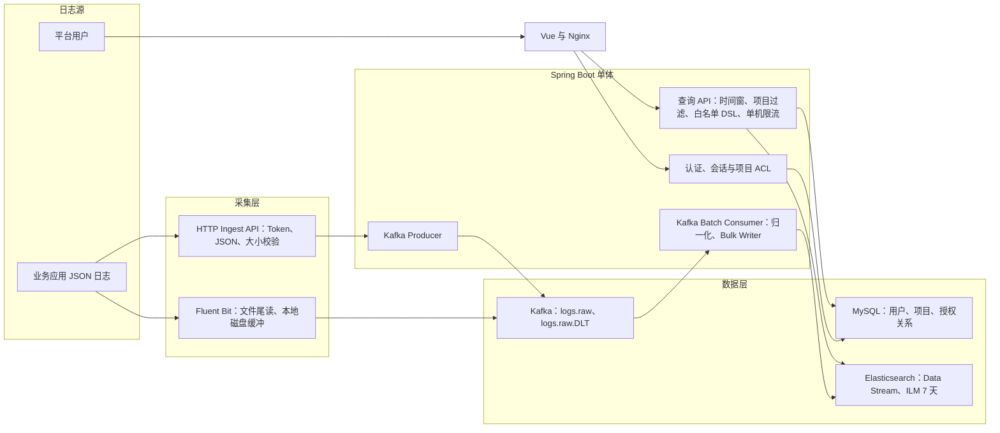
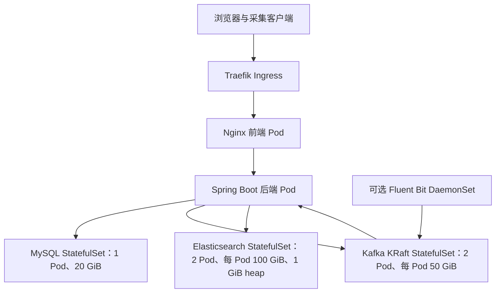
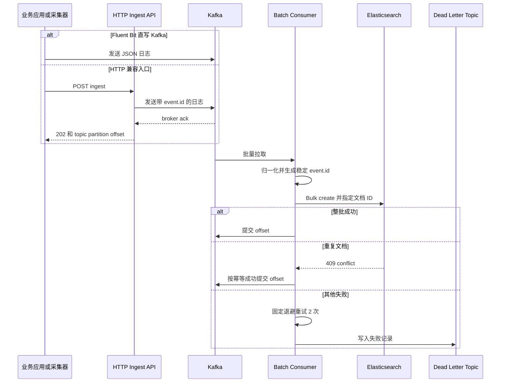
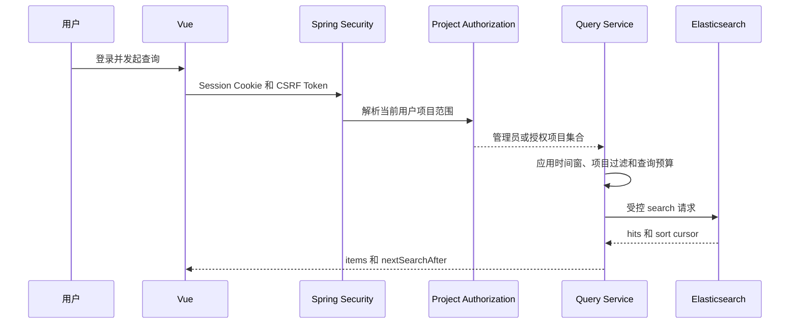
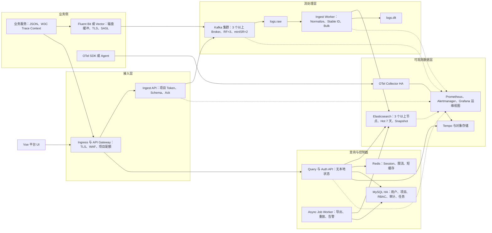

# 日志平台当前架构、容量评估与总体蓝图

> 评估基线：2026-09-30，分支 `dev`，提交 `7cd1ba2`。本文以仓库中的代码、配置、部署清单和测试为事实依据。
> 状态定义：**已实现**表示存在可构建代码；**基线可部署**表示 K3s 清单已覆盖；**仅设计**表示只有文档或示例配置；**待验证**表示没有集成测试或压测证据。

本蓝图对应的落地设计与功能架构见：[功能架构图](functional-architecture.md)、[分阶段开发与详细设计](phased-development-design.md)。当前已完成 Phase 0 边界契约、Phase 1 可观测数据面代码基线、API/Consumer 解耦部署基线，以及 Phase 2 聚合分析和异步 CSV 导出；真实 Kafka/ES/K3s/Redis 联调、HA、压测和故障演练仍待现场验证。

四类现状视图（功能蓝图、产品能力图、系统拓扑图、业务链路图）及模块完整度汇总见：[当前系统功能蓝图与链路完整度](current-system-blueprint.md)。

## 1. 执行摘要

当前项目是一个面向小规模、多项目接入的日志检索 MVP：Vue 单页前端通过 Spring Boot 单体后端完成会话登录和日志检索；Fluent Bit 或 HTTP 接口将日志送入 Kafka；同一个后端进程批量消费、归一化后写入 Elasticsearch Data Stream；MySQL 保存平台用户、项目和授权关系。

项目已经具备“采集、缓冲、规范化、7 天存储、受控查询、基础登录、K3s 双实例数据面部署”的主干。本轮已完成六项正确性与安全修复：

1. 查询游标改为 `@timestamp + event.id`，不再对 Elasticsearch `_id` 排序。
2. Kafka 消费使用 `project.id + event.id` 的稳定摘要作为 ES 文档 `_id`，重复 `create` 的 409 按幂等成功处理。
3. HTTP 入口收到 Kafka broker ack 后才返回 `202`，失败或超时返回 `503`。
4. 普通用户的搜索、详情、上下文和聚合统一强制项目 ACL，未分配项目时 fail closed。
5. 应用不再提供数据库默认地址、账号或密码；管理员通过 Secret 在启动时创建或同步。
6. Trace 后端统一为 Tempo，链路固定为 OTel Agent -> OTel Collector -> Tempo。

当前仍不能按生产级日志平台验收，主要缺口是：容量结论尚未压测；MySQL 和 Redis 清单仍是单节点，Kafka 双 controller 不能容忍单节点故障后继续选主，ES 双节点的 TLS、认证和快照仍未完成；Prometheus 抓取、告警、备份恢复、Tempo 部署和故障演练尚未完成。Session/限流已经提供 Redis 开关，但 Redis 单副本不代表 HA。`300 EPS` 仍只是按 500 万条/天平均流量的 5 倍得到的设计目标，不是实测吞吐。

因此，当前准确口径是：**功能型 MVP，设计写入峰值 300 EPS，实测可支撑 QPS 未知，暂不具备生产 SLA 承诺条件。**

## 2. 当前系统边界

### 2.1 模块与职责

| 模块 | 技术 | 当前职责 | 状态 |
|---|---|---|---|
| `log-platform-ui` | Vue 3.5、Vite 6、Element Plus | 登录、条件检索、游标翻页、结果列表、前端本地详情抽屉 | 已实现 |
| `log-platform-ai-admin` | Java 21、Spring Boot 3.5.3 | 登录鉴权、HTTP 采集、Kafka 消费、日志归一化、ES 写入与查询 | 已实现 |
| `log-platform-ai-common` | Java record/domain | 用户、登录态、统一响应、日志事件模型 | 已实现 |
| MySQL 8.4 | JDBC | 平台用户、项目和用户项目授权 | 基线可部署 |
| Kafka 3.9.1 | KRaft | 原始日志缓冲、削峰、重放、死信 Topic | 双实例基线可部署，生产需奇数 controller/TLS |
| Elasticsearch 8.15.3 | Data Stream、ILM | 日志索引、全文检索、聚合、7 天生命周期 | 双实例基线可部署，生产需 TLS/认证/快照 |
| Fluent Bit 3.2.10 | tail、磁盘 buffer、Kafka output | 采集 `/var/log/apps/*.log` 并直写 Kafka | 可选基线可部署 |
| OTel Collector | OTLP | Trace/Metric/Log 管线、尾采样、发送队列和健康端点 | 可选纳入 K3s，Tempo/Loki 需外部提供 |
| Tempo | Trace backend | 完整 Trace 存储与查询 | 联查 API 已实现；后端仍由外部观测栈提供 |

### 2.2 当前逻辑架构



### 2.3 当前 K3s 部署拓扑



该拓扑提供 K3s 内部双实例基线，Kafka Topic 副本因子和 Elasticsearch 节点数均为 2；两个 KRaft controller 无法在单节点故障后继续选主，因此不是完整的生产高可用拓扑。生产环境应使用奇数 Kafka controller、TLS/SASL、ES TLS/认证和 Operator 管理的节点拓扑。

## 3. 核心设计方案

### 3.1 日志写入链路



设计要点：

- Kafka Producer 配置 `acks=all`、幂等生产、LZ4 和有限重试。
- HTTP 入口要求 JSON 对象和 `project.id`，支持共享采集 Token，最大逻辑载荷 1 MiB。
- Kafka key 在 HTTP 路径按 `project.id|service.name|environment` 生成；Fluent Bit 直写路径没有落实同样的 key 规则。
- HTTP 入口在有界超时内等待 Kafka broker ack；成功响应包含 `eventId`、topic、partition 和 offset。
- Consumer 使用批量监听，成功写入 ES 后才允许监听器正常返回并提交 offset，语义为 at-least-once。
- 归一化字段参考 OTel/ECS，平台重写 `event.ingested`，允许 `http` 和 `attributes` 扩展字段。
- HTTP 缺少 `event.id` 时生成 UUID；Kafka 直写缺少该字段时使用 topic、partition、offset 生成稳定后备 ID。
- ES 使用 Data Stream、受控 mapping、`dynamic=false` 和 7 天 ILM；Bulk `create` 的 `_id` 是 `project.id + event.id` 的 SHA-256，既支持重放幂等，也避免不同项目的相同事件 ID 冲突；409 视为已写入。

需要澄清的实现事实：

- `bulk-max-actions=1000` 与 `bulk-flush-interval-ms=1000` 目前只是配置项，写入代码没有读取它们；实际批大小主要受 Kafka `max.poll.records` 默认值和当次 poll 结果控制。
- 当前 listener 没有显式配置 `concurrency`，单后端实例只有一个 listener consumer；增加后端副本才会增加同一 consumer group 的并行消费者。
- 历史索引需要先更新 mapping 并回填 `event.id`，才能与新游标兼容；仓库提供了 `_update_by_query` 脚本。
- HTTP 的 `202` 只表示 Kafka 已确认，不表示 Elasticsearch 已经可查。

### 3.2 查询链路



已落地的保护：

- 管理员身份来自服务端登录态，不接受客户端传入的管理员标记。
- 普通用户只能查上海时区当天；管理员最多回溯 168 小时。
- 查询过滤字段和聚合字段使用白名单，客户端不能提交原始 ES DSL。
- 单页最大 500 条、聚合最多 3 层且每层最多 100 个 bucket。
- ES 查询超时 3 秒，HTTP 读超时 5 秒；单实例最多 20 个并发查询。
- 详情和上下文 API 会再次应用时间权限，而不是按文档 ID 直接读取。
- 普通用户的搜索、详情、上下文、聚合都从数据库解析授权项目；未分配项目时拒绝请求，指定越权项目时返回 403。
- 分页固定按 `@timestamp desc, event.id desc` 排序，游标必须包含两个排序值。

当前限制：

- 服务没有检查 ES 响应中的 `timed_out`，ES 返回部分结果时可能仍以成功响应透传。
- 限流是固定分钟窗口，不是注释中所称的滑动窗口；计数 Map 没有过期清理，长期运行会随不同用户/IP 增长。
- 已有项目 ACL，但还没有项目级角色、项目配额、字段脱敏和查询审计。
- `search_after` 尚未结合 PIT，跨 refresh/rollover 的长分页不保证一致快照。
- 前端只调用 `/search`；后端已有详情、上下文、聚合 API，但 UI 尚未接入。前端详情抽屉直接使用列表项的 `_source`。

### 3.3 登录与权限

- 用户存储在 MySQL `sys_user`，密码使用 BCrypt cost 12。
- 使用服务端 `JSESSIONID` 会话、Session Fixation 防护和 Cookie CSRF Token。
- 角色模型目前只有 `is_admin`；普通用户通过 `sys_user_project` 关联启用项目，管理员可访问全部项目。
- 会话保存在单个后端 JVM/Tomcat 中，多副本部署没有共享 Session 或粘性会话。
- 登录接口没有失败次数限制、验证码、账号临时锁定或 IP 限流。
- `DB_URL`、`DB_USERNAME`、`DB_PASSWORD` 均为必填环境变量；部署脚本拒绝 root 应用账号和 `change-me-*` 占位秘密。
- 启动管理员由 `BOOTSTRAP_ADMIN_*` Secret 创建或同步，SQL 不再保存固定账号和密码。

### 3.4 数据模型与生命周期

核心索引字段包括：

- 时间与标识：`@timestamp`、`event.ingested`、`event.id`
- 租户/部署：`project.id`、`deployment.environment`
- 服务：`service.name`、`service.instance.id`
- 链路：`trace.id`、`span.id`
- 日志：`log.level`、`log.logger`、`message`
- 代码与错误：`code.namespace`、`code.function`、`error.type`、`error.stack_trace`
- 扩展：受控 `http.*`、`user.id_hash`、`attributes` flattened

共享 Data Stream `logs-platform-default` 使用 7 天删除策略。当前 ILM 只有 hot 和 delete，没有实际 warm tier；文档中的“3～7 天 Warm”仍是目标设计。

## 4. 能力盘点

| 能力域 | 能力 | 后端 | 前端/部署 | 结论 |
|---|---|---:|---:|---|
| 认证 | MySQL 用户、BCrypt、Session、CSRF、登录/退出/当前用户 | 已实现 | 已接入 | 默认内存 Session；设置 `SESSION_STORE_TYPE=redis` 后可共享，Redis HA 待验证 |
| 采集 | Fluent Bit 文件 tail + 磁盘缓冲 + Kafka output | 不经过后端 | 可选 DaemonSet | 基线可用，未做容器 stdout 自动发现 |
| 采集 | HTTP JSON 入口、共享 Token、1 MiB 逻辑限制 | 已实现 | 无管理界面 | broker ack 后返回 202；项目独立 Token 已支持轮换 |
| 消息 | `logs.raw`、6 分区、DLT、生产者幂等 | 已实现 | 初始化 Job | 双实例可运行，生产 HA 未实现 |
| 处理 | 日志字段归一化 | 已实现 | - | 有单元测试 |
| 处理 | 批量消费、稳定 ID、幂等写入、失败重试、DLT | 已实现 | - | 有单元测试，无 Kafka/ES 集成测试 |
| 存储 | Data Stream、受控 mapping、7 天 ILM | 已实现 | 初始化 Job | 双 ES 基线可用，生产认证/快照未实现 |
| 检索 | 时间、项目、环境、服务、实例、Trace、Span、级别、错误、关键字、属性 | 已实现 | 已接入主要字段 | 固定 `@timestamp + event.id` 排序 |
| 分页 | `search_after` | 已实现 | 已接入 | 稳定游标已实现；PIT 待实现 |
| 详情 | 服务端权限约束详情 API | 已实现 | 已接入详情抽屉 | 详情失败保留列表快照 |
| 上下文 | 前后 0～300 秒、最多 100 条、同 Trace/服务 | 已实现 | 已接入详情抽屉 | 真实 ES 联查待验证 |
| 聚合 | 最多 3 层白名单 terms 聚合 | 已实现 | 已接入级别/服务/环境摘要 | 聚合失败不影响主查询 |
| 权限 | 普通用户当天、管理员 7 天 | 已实现 | 展示角色 | 已实现 |
| 多租户 | 按项目授权 | 已实现 | SQL 与查询 API 已接入 | 普通用户 fail closed；管理员全项目 |
| 多租户 | 项目级角色、配额、独立 Token | 未实现 | 未实现 | 待实现 |
| Trace | 日志保存/过滤 trace、span id | 已实现 | 可按 Trace 过滤日志 | 只有关联字段 |
| Trace | Span 存储、拓扑、瀑布图、日志/Span 联查 | 日志/Tempo 联查 API 已实现 | Tempo 后端外部提供 | 前端瀑布图和真实 Tempo 联调待验证 |
| 产品 | 日志分析摘要 | 聚合 API 已接入 | 已接入级别/服务/环境 Top 分布 | 真实 ES 聚合待验证 |
| 产品 | 告警规则、通知、静默/升级 | PrometheusRule 与 Runbook 已实现 | Alertmanager/通知渠道外部提供 | 静默、升级和通知联调待实现 |
| 产品 | 异步 CSV 导出 | 有界 Worker、ACL/时间窗/脱敏、10,000 行/50 MiB、过期下载 | API 已接入 | 应用内存结果；对象存储和多副本一致性待实现 |
| 产品 | 保存查询、分享 | 未实现 | 未实现 | 待实现 |
| 治理 | 查询/管理审计、敏感字段脱敏 | 已实现 | 已接入查询链路 | 异步导出审计和告警待补 |
| AI | 摘要、根因分析、自然语言查询、语义检索 | 未实现 | 未实现 | 项目名含 AI，但暂无业务能力 |
| 运维 | K3s 安装、初始化、健康检查、入口冒烟 | 已实现 | 已实现 | Kafka/ES 双实例基线；MySQL/Redis 单 Pod |
| 运维 | Actuator/Prometheus 指标 | 已实现入口、消费、Bulk、查询、导出指标 | `/actuator/prometheus` 已暴露 | Prometheus/告警接入待验证 |
| 运维 | PDB/HPA/NetworkPolicy/Redis 清单 | 已实现 K3s 基线 | 可部署 | metrics-server、策略和 Redis HA 待验证 |
| 运维 | Dashboard、备份恢复、故障演练 | 未实现 | 未实现 | 生产阻断项 |

## 5. 架构优点

1. **写入解耦方向正确**：Kafka 把采集流量与 ES 波动隔离，为削峰、重放和故障恢复留下空间。
2. **生命周期与业务约束匹配**：Data Stream + ILM 适合 7 天短周期日志，`dynamic=false` 能降低字段爆炸风险。
3. **查询边界在服务端强制执行**：时间窗、页大小、并发、频率和聚合字段均不依赖前端自觉，减少误用与越权面。
4. **统一事件模型清晰**：字段参考 OTel/ECS，日志与 Trace 具备通过 `trace.id` / `span.id` 关联的基础。
5. **MVP 采用模块化单体是合理的**：代码量小、部署简单、事务和调试成本低；现阶段没有必要直接拆成大量微服务。
6. **部署具有基本可重复性**：Topic、DLT、ES 模板、ILM、Data Stream、应用镜像和冒烟脚本均已纳入仓库。
7. **安全基线优于裸接口**：BCrypt、Session Fixation、CSRF、HttpOnly Cookie、查询 DSL 白名单和详情时间窗已经存在。

## 6. 架构缺点与风险

### 6.1 本轮已关闭的 P0 风险

| 风险 | 已实施措施 | 验证状态 |
|---|---|---|
| `_id` 排序 | 新增 keyword 类型 `event.id`，排序固定为 `@timestamp,event.id`；提供旧数据回填脚本 | 单元测试通过；真实 ES 8 回归待补 |
| 非幂等消费 | 使用 `project.id + event.id` 的稳定摘要作为 Bulk `_id`，409 conflict 视为幂等成功，其他单条失败触发批次重试 | 单元测试通过；Kafka + ES 故障重放待测 |
| HTTP 假确认 | 在配置超时内等待 Kafka Future；ack 后返回 202，超时或失败返回 503 | 单元测试覆盖成功和超时；真实 broker 待测 |
| 项目间越权 | 新增项目及用户项目关系；搜索、详情、上下文、聚合强制注入授权范围 | 服务和控制器测试通过；端到端 ACL 冒烟待补 |
| 默认数据库凭据 | 删除应用默认数据库配置与 SQL 固定账号；Secret 初始化管理员；部署校验占位秘密 | 配置静态检查通过；凭据轮换由环境执行 |
| Trace 决策冲突 | ADR、Collector 和文档统一采用 Tempo，移除其他 Trace 后端配置口径 | 静态配置与日志/Tempo 联查 API 已统一；Tempo 服务和前端联调待验证 |

### 6.2 P1：生产稳定性缺口

- Kafka、ES、MySQL 均为单点，K3s 节点本身也是故障域；任一节点或磁盘故障都会中断服务。
- Kafka/ES 为明文无认证连接；ES 清单显式关闭安全功能。
- 后端只使用配置中的第一个 ES endpoint，没有节点发现、故障转移或读写客户端隔离。
- 默认 Session、限流计数和并发 Semaphore 在 JVM 内；K3s 可通过 `SESSION_STORE_TYPE=redis` 和 `LOG_QUERY_DISTRIBUTED_RATE_LIMIT=true` 使用共享 Redis，但 Redis 当前是单副本，连通性和 HA 尚未演练。
- 查询和消费位于同一进程、共享 ES 客户端和 CPU/内存资源，重查询可能影响写入，反之亦然。
- 消费并发、poll 批大小、Bulk 大小和 flush 时间没有形成一套实际生效的配置。
- DLT 只有写入路径，没有重放工具、处理状态、告警和毒消息隔离流程。
- 已提供 Actuator/Micrometer 指标和 Prometheus 端点；Prometheus 抓取规则、Grafana/Alertmanager 告警以及 Kafka lag/JVM/磁盘看板仍未部署验证。
- 无 ES Snapshot、MySQL 备份、Kafka 故障恢复方案和恢复演练记录。
- 冒烟测试只确认前端、CSRF 和 Kafka 入口返回 202，没有验证日志最终进入 ES 并可被授权用户查询。

### 6.3 P2：产品与工程完整性缺口

- 前端已接入详情、上下文和聚合摘要，并提供异步 CSV 导出 API；仍缺少 Trace 视图、告警、保存查询、分享和项目切换。
- 没有 OpenAPI 契约、API 版本、兼容策略和前后端契约测试。
- 查询服务透传原始 `_source`，缺少字段级脱敏、响应 schema 稳定性和大字段裁剪。
- 登录没有防爆破机制；管理员密码虽由 Secret 管理，但还没有强制改密、轮换审计和外部身份源。
- 前端保留大量未使用的旧路由、工具和 AI 相关依赖，增加依赖体积、漏洞面和维护噪声。
- 没有 CI 清单、代码质量门禁、容器镜像扫描、SBOM、签名和制品晋级策略。

## 7. QPS / EPS 容量评估

### 7.1 必须区分的三个指标

- **EPS（events/s）**：每秒日志事件数，是 Kafka 和 ES 写入链路的核心指标。
- **入口 QPS（requests/s）**：HTTP `/ingest` 每秒请求数；若一请求一事件，则数值接近 EPS。Fluent Bit 直写 Kafka 时不存在这部分后端 QPS。
- **查询 QPS**：每秒搜索、详情、上下文和聚合请求数，成本与时间范围、命中数、聚合基数和 ES 节点资源强相关，不能从日志 EPS 直接推导。

### 7.2 当前容量基线

| 参数 | 当前值 | 性质 |
|---|---:|---|
| 项目数 | 5 | 业务输入 |
| 每项目日志 | 100 万条/天 | 保守假设 |
| 总日志 | 500 万条/天 | 计算值 |
| 平均 EPS | 57.9 | `5,000,000 / 86,400` |
| 设计峰值 | 300 EPS | 平均值约 5 倍，未实测 |
| 平均事件大小 | 1.5 KiB | 假设，需真实样本校准 |
| 原始数据量 | 约 7.15 GiB/天 | 计算值 |
| ES 7 天主数据 | 约 75.1 GiB | 含 1.5 倍索引放大，不含副本 |
| 生产 ES 预算 | 约 225.3 GiB，建议至少 300 GiB 可用 | 1 副本 + 50% 余量 |
| 当前 K3s ES | 2 节点、每节点 100 GiB，1 GiB heap，2 CPU 上限 | 开发基线，不满足生产预算 |
| Kafka 2 天生产预算 | 约 42.9 GiB，建议每 broker 100 GiB | 含副本与余量 |
| 当前 K3s Kafka | 2 broker、每 broker 50 GiB，1 CPU 上限 | 开发基线 |

### 7.3 写入能力推导

当前单后端实例只有一个 Kafka listener consumer。设：

- `B`：每批实际记录数；未显式配置时上限通常受 Kafka 默认 `max.poll.records=500` 约束；
- `T_bulk`：一次归一化加 ES Bulk 往返的平均耗时，单位秒；
- `C`：活跃 consumer 数，不能超过分区数；当前单副本基线 `C=1`；
- `Q_es`：ES 在当前 mapping、refresh、磁盘和查询负载下的可持续写入能力。

则写入链路上限近似为：

```text
EPS_write <= min(C * B / T_bulk, Q_es, Kafka 可持续吞吐)
```

若实际每批能达到 500 条，单 consumer 为满足不同目标，Bulk 全链路平均耗时至少应满足：

| 目标 | 单批 500 条时要求 | 说明 |
|---|---:|---|
| 300 EPS | `T_bulk <= 1.67s` | 当前设计峰值 |
| 450 EPS | `T_bulk <= 1.11s` | 设计峰值加 50% 余量 |
| 600 EPS | `T_bulk <= 0.83s` | 2 倍突发验证目标 |

这只是必要条件，不是测量结果。实际批次在低流量、重平衡、部分失败和 poll 周期下可能小于 500；双节点 ES 仍同时承担读写时，`Q_es` 往往先成为瓶颈。

当前可以对外给出的容量口径：

- **规划目标**：持续 300 EPS，验证 600 EPS 短时突发。
- **已证明能力**：无吞吐压测数据，不能声明“已支持 300 EPS”。
- **上线验收建议**：生产等价数据和 mapping 下，450 EPS 持续 60 分钟，600 EPS 突发 10 分钟；无静默丢失，端到端延迟 P95 小于 5 秒，恢复后 consumer lag 能在 15 分钟内回落。

### 7.4 查询 QPS 推导

当前单实例查询并发硬上限是 20。按 Little's Law，在不考虑队列、客户端重试和应用开销时：

```text
查询 QPS 理论上限 ≈ 最大并发数 / 平均响应时间（秒）
```

| 平均响应时间 | 20 并发对应的近似上限 | 解读 |
|---:|---:|---|
| 0.5 s | 40 QPS | 仅适用于小时间窗、过滤命中快的查询 |
| 1 s | 20 QPS | 较理想的常规过滤查询 |
| 2 s | 10 QPS | 现有 24 小时查询 P95 目标附近 |
| 3 s | 6.7 QPS | 已接近 ES DSL 超时，不应作为常态容量 |

同时存在以下限制：

- 单个用户/IP 每分钟 120 次，相当于长期平均 **2 QPS/用户/IP**。
- 20 并发和 120 次/分钟都是**每个后端实例**的内存限制；不能把增加副本后的简单倍增视为有效扩容，因为 Session 和限流尚未分布式化。
- 聚合、7 天查询、通配关键字和高基数属性查询的成本远高于详情查询，必须分场景压测。
- 当前每个 ES 节点只有 1 GiB heap，且与写入共享资源，无法据此承诺 10 QPS 或 20 QPS 的生产容量。

当前可以对外给出的查询口径：

- **保护阈值**：单实例最多 20 个在途查询；单用户/IP 120 次/分钟。
- **规划目标**：当天查询 P95 < 2 秒；管理员 7 天查询 P95 < 5 秒；20 个同时活跃查询。
- **实测 QPS**：未知。按 2 秒响应和 20 并发推导的 10 QPS 只是容量模型起点，不是 SLA。

### 7.5 压测与容量验收方案

1. **数据准备**：导入至少 7 天、3500 万条、1.5 KiB p50 且包含异常堆栈 p95/p99 的代表性数据；确保 mapping、分片和 ILM 与生产一致。
2. **写入阶梯**：分别测试 60、150、300、450 EPS 各 30 分钟，600 EPS 10 分钟，再做 300 EPS 24 小时稳定性测试。
3. **入口拆分**：分别测试 Fluent Bit 直写 Kafka 和 HTTP 单事件入口，记录 producer ack、入口错误率和端到端可见延迟。
4. **查询矩阵**：按 15 分钟/24 小时/7 天、精确过滤/全文/Trace/聚合、20/50/500 页大小组合测试；并发阶梯 1、5、10、20、30。
5. **混合负载**：在 300 EPS 持续写入下执行查询矩阵，确认读负载不会造成 consumer lag 持续增长。
6. **故障场景**：Kafka broker、consumer、ES 节点和后端 Pod 分别重启；验证已确认消息不丢、重复可控、DLT 可观测、积压可恢复。
7. **通过条件**：错误率 < 0.1%；无未解释丢失；写入可见 P95 < 5 秒；当天查询 P95 < 2 秒；7 天查询 P95 < 5 秒；ES rejection < 1%；故障恢复符合 RTO/RPO。

## 8. 目标总体蓝图

目标架构继续保留 Kafka + Elasticsearch 的主方向，并把 API 和消费 Worker 作为同一代码库的不同部署角色，先获得资源隔离和独立扩缩容，不急于拆成多个独立微服务。



### 8.1 目标设计原则

1. **确认过的消息不丢**：入口只有收到 Kafka broker ack 才返回成功；consumer 在 ES 成功或确认幂等冲突后提交 offset。
2. **至少一次 + 业务幂等**：采用稳定 `event.id`，允许 Kafka 重试而不产生重复日志。
3. **控制面与数据面隔离**：用户/RBAC/任务在 MySQL；日志在 ES；Trace 在 Tempo；缓存和共享状态在 Redis。
4. **查询必须有预算**：按用户、项目、查询类型设置速率、并发、时间窗、页大小和导出配额。
5. **先模块化部署，再按必要性拆服务**：API 和 Worker 独立部署；只有团队边界、发布频率或容量瓶颈明确时才拆仓/拆服务。
6. **可观测性是上线条件**：每条关键链路必须有吞吐、延迟、错误、积压和容量指标，并有对应告警与 Runbook。
7. **唯一 Trace 后端**：遵循 Accepted ADR 使用 Tempo；Collector、部署配置、版本矩阵和 UI 集成都以 Tempo 为唯一目标。

### 8.2 建议 SLO

| SLI | 建议目标 |
|---|---|
| 采集 API 可用性 | 月度 99.9% |
| 已确认日志丢失率 | 0；以 Kafka ack 后的事件为统计边界 |
| 端到端可见延迟 | 300 EPS 下 P95 < 5 秒，P99 < 15 秒 |
| 当天检索延迟 | P95 < 2 秒，P99 < 5 秒 |
| 7 天检索延迟 | P95 < 5 秒，超大查询引导异步化 |
| Trace 关联完整率 | 有效 W3C Trace 日志中，日志与 Span 关联成功率 >= 99.9% |
| 查询 API 可用性 | 月度 99.9% |
| 数据恢复 | MySQL/ES 元数据 RPO <= 15 分钟，RTO <= 2 小时；以演练结果为准 |

## 9. 分阶段路线图

### Phase 0：正确性与安全闭环（生产准入）

- 已完成：稳定 `event.id`、ES 可排序游标、消费幂等、HTTP broker ack、全查询路径项目 ACL、Secret 管理数据库与管理员凭据、Tempo 单一决策。
- 补 Kafka + ES Testcontainers 集成测试，覆盖重放、部分 Bulk 失败、Data Stream rollover 和历史数据回填。
- 为 HTTP 入口增加请求体传输层硬限制、入口限流和每项目独立 Token。
- 在现有 user-project 数据模型上增加项目角色、敏感字段脱敏和查询审计。
- 增加 secret scan，并在实际环境完成历史数据库凭据轮换。
- 让冒烟测试覆盖“写 Kafka -> 消费 -> ES 可查 -> 普通用户不可越权”。

完成标准：主链路端到端测试通过，P0 风险清零，开发环境 300 EPS 基准测试通过。

### Phase 1：高可用、可观测与容量认证

- **已完成可部署基线**：双实例 Kafka/ES、Micrometer/Actuator 指标、Redis StatefulSet 与 Session/分布式限流开关、PDB/HPA/NetworkPolicy、资源 requests/limits。
- **待实现**：Kafka 至少 3 broker、RF=3、minISR=2；ES 至少 3 节点并启用副本、TLS、认证和 Snapshot；MySQL 使用受管 HA 或主从方案。
- **已完成代码/部署基线**：API 与 ingest worker 分成独立 Deployment；consumer concurrency、poll 和 Bulk 动作上限已配置化；Bulk 字节上限仍待补充。
- **待验证**：Prometheus/Grafana/Alertmanager 抓取和告警、Redis 连通性与故障切换、滚动升级和 NetworkPolicy 规则。
- **待验证**：按第 7.5 节完成混合压测、24 小时稳定性测试与故障演练，发布正式容量报告。

完成标准：450 EPS 持续、600 EPS 突发和 20 并发混合查询通过；单节点故障不丢已确认日志，SLO 可监控。

### Phase 2：日志产品能力完善

- **已完成**：前端服务端详情、上下文和聚合摘要；异步 CSV 导出（有界 Worker、权限复用、限时下载）。
- **已完成基础能力**：Tempo Trace 联查 API、Prometheus 告警规则、告警 Runbook；字段选择、保存查询、分享链接、项目切换、前端瀑布图仍待实现。
- **仍待实现**：静默、通知渠道、升级策略与告警历史持久化。
- **待生产化**：导出任务迁移到 Redis/持久队列，结果进入对象存储并补齐审计、配额和跨副本一致性。
- **待实现**：DLT 管理与安全重放、数据质量面板、Schema 版本和采集 SDK/接入向导。

完成标准：排障、分析、告警、导出和 Trace 联查形成完整用户闭环。

### Phase 3：规模化与 AI 能力

- 为固定看板构建预聚合/Transform 索引，隔离高基数实时聚合；按容量决定 hot/warm 或对象存储归档。
- 引入项目级成本和配额治理：EPS、存储、查询 CPU、导出量、Trace 采样率。
- AI 能力作为独立异步任务域：日志摘要、异常聚类、根因候选、自然语言到受控查询；不得允许模型直接提交任意 ES DSL。
- AI 调用实施项目配额、脱敏、审计、缓存、超时、降级和效果评测；不阻塞基础检索链路。

完成标准：在不降低日志主链路 SLO 和安全边界的前提下提供可评测、可控成本的智能分析。

## 10. 关键演进决策

| 决策 | 当前建议 | 触发重新评审的条件 |
|---|---|---|
| 单体还是微服务 | 保留模块化单体代码库，API/Worker 分部署 | 团队所有权分离、独立发布频率或单模块容量成为长期瓶颈 |
| Kafka 是否保留 | 保留 | 只有流量极低且能接受 ES 故障期间丢失/阻塞时才考虑移除 |
| ES 索引组织 | 共享 Data Stream + `project.id` 逻辑隔离 | 单项目占大多数容量、需要独立生命周期/合规/性能隔离 |
| Trace 后端 | Tempo，遵循已接受 ADR | 合规、成本或可用性要求发生重大变化，并通过新 ADR 重新决策 |
| 鉴权方式 | 短期 Session + Redis | 对外 API、跨域多客户端或统一身份平台接入时评估 OIDC/OAuth2 |
| 长期日志 | 7 天 ES，历史走 Snapshot/对象存储 | 合规要求在线查询更长时间时重新建模成本与冷热层 |

## 11. 本轮交付索引

| 产物 | 路径 | 状态 |
|---|---|---|
| 功能架构图 | `docs/architecture/functional-architecture.md` | 已更新，包含指标、Redis、导出 Worker、HPA/PDB/NetworkPolicy 和前端分析 |
| 分阶段详细设计 | `docs/architecture/phased-development-design.md` | 已更新，包含 Phase 1/2 状态、导出 API 契约和验证边界 |
| 异步导出实现 | `log-platform-ai-admin/src/main/java/com/zhouyi/admin/service/LogExportService.java` | 已实现，有界线程池、ACL/时间窗复用、CSV 脱敏、过期清理 |
| 导出 API | `log-platform-ai-admin/src/main/java/com/zhouyi/admin/controller/LogQueryController.java` | 已实现创建、状态、下载接口 |
| 前端分析摘要 | `log-platform-ui/src/App.vue`、`src/api/platform.js`、`src/styles/index.scss` | 已实现级别/服务/环境 Top 分布 |
| 可观测与部署基线 | `PlatformMetrics.java`、`deploy/k3s/manifests/35-redis.yaml`、`45-backend-availability.yaml` | 已实现清单；真实集群待验证 |
| Phase 1 容量验收模板 | `docs/capacity/phase1-capacity-acceptance.md`、`deploy/k3s/capacity/ingest-load.sh` | 已提供执行矩阵；无现场压测结论 |

## 12. 事实依据与验证状态

主要依据：

- 后端配置与保护边界：`log-platform-ai-admin/src/main/resources/application.yml`
- 采集与消费：`LogIngestService`、`LogKafkaConsumer`、`ElasticsearchLogWriter`、`LogIngestConfiguration`
- 查询与限流：`LogQueryService`、`LogQueryWindowService`、`LogQueryLimiter`
- 登录与权限：`SecurityConfig`、`LoginController`、`SysUserRepository`
- 前端已接能力：`log-platform-ui/src/App.vue`、`src/api/platform.js`
- 数据与生命周期：`deploy/elasticsearch/logs-index-template.json`、`deploy/k3s/config/ilm-policy.json`
- 部署资源：`deploy/k3s/manifests/`、`deploy/k3s/install.sh`
- 现有容量假设：`docs/capacity/log-platform-capacity-model.md`
- 架构决策：`docs/adr/ADR-001-kafka-elasticsearch-tempo-observability.md`

本次静态核验结果：

- Maven：40 个测试通过，0 failures/0 errors；覆盖登录安全边界、项目 ACL、查询游标、日志归一化、Kafka ack、管理员初始化、ES 幂等写入和异步导出 CSV/所有权。
- Vue：`npm run build:prod` 生产构建通过。
- Shell：K3s 安装、预检、冒烟、卸载和容量输入脚本通过 `bash -n`；K3s YAML 可由 Ruby Psych 解析。
- K3s 清单：全部 manifest 经 `envsubst` 后无残留变量，并通过 YAML 解析。
- Mermaid：本文 5 张图均通过 Mermaid 11.14 语法解析。
- 未执行：真实 Kafka/ES/MySQL/K3s 端到端测试、性能压测、故障演练和浏览器端功能测试。

在这些未执行项完成前，本文中的容量数字应作为规划和压测输入，而不是生产承诺。
