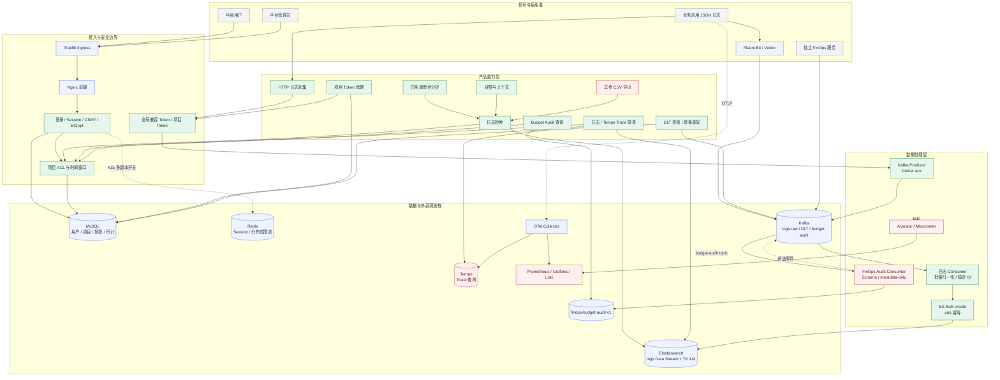
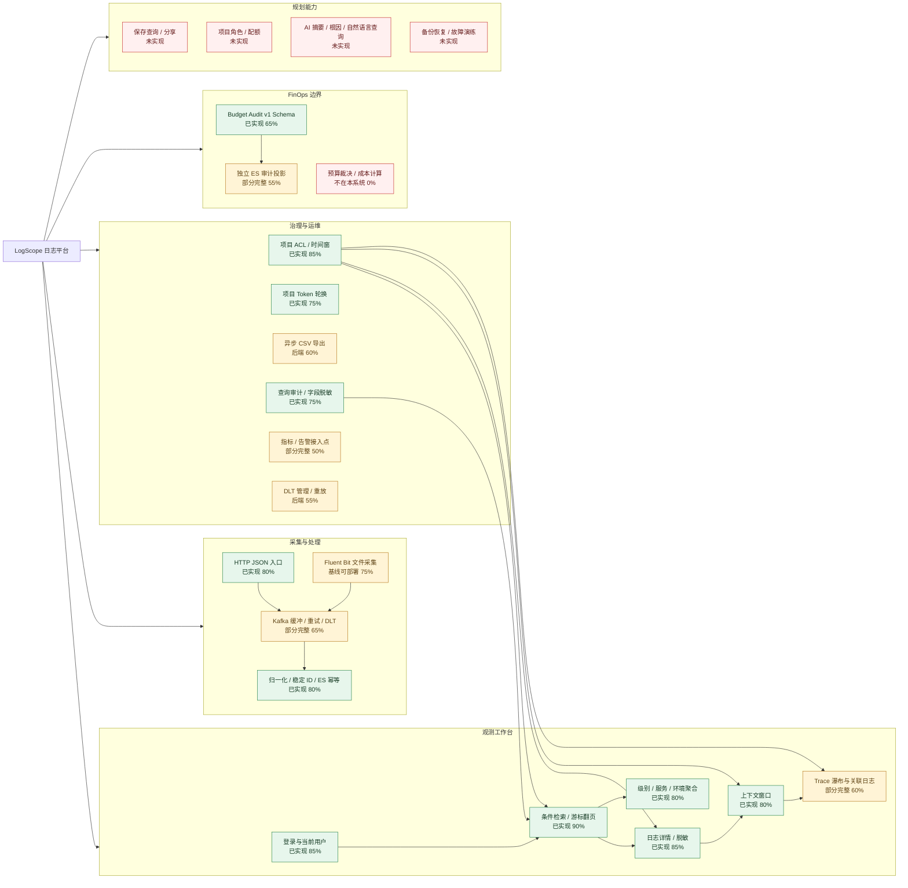
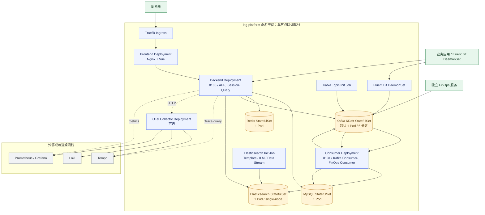
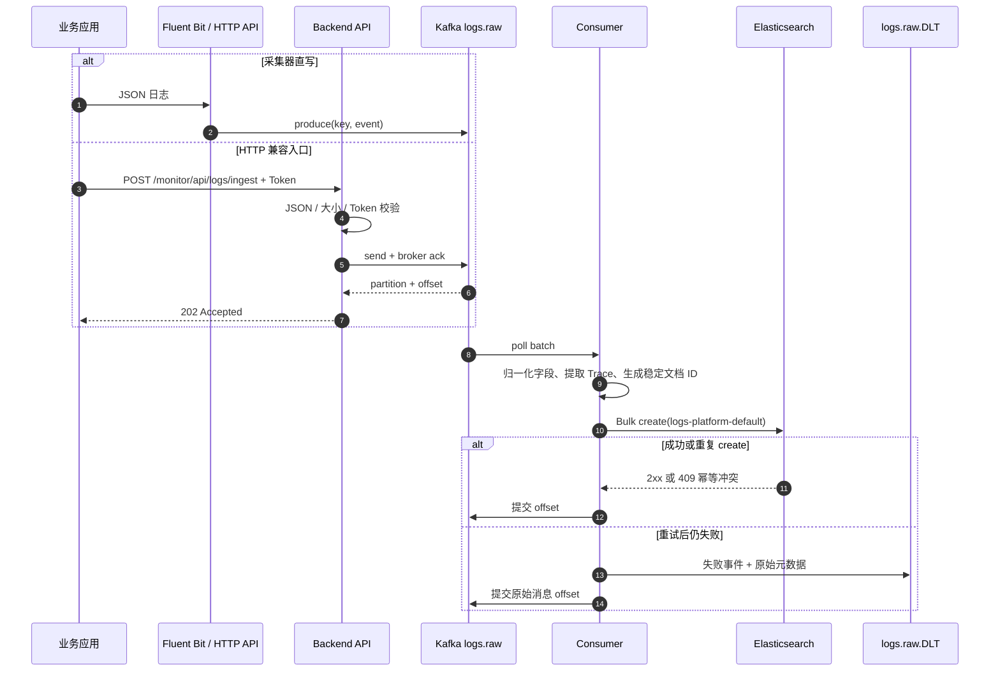
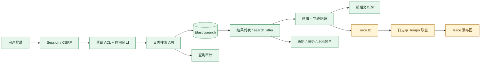
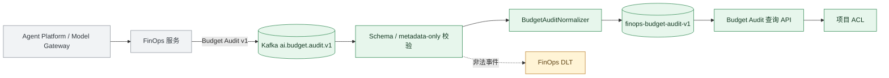

# 当前系统功能蓝图与链路完整度

> 评估基线：2026-10-10。本文只描述仓库当前可见的代码、前端、配置和 K3s 清单，不把设计文档中的目标状态当作已交付能力。
>
> 完整度是工程交付口径，不是运行时成功率或 SLA：`75%+` 表示主干代码、接口/界面、部署基线和自动化验证大部分具备，但仍有真实环境联调、HA 或运维门禁缺口；`50%~74%` 表示可用主干存在，但有明显入口、部署或验证缺口；`<50%` 表示设计/代码片段存在，尚不能作为稳定产品能力。

## 1. 统一图例与边界

| 标记 | 含义 |
|---|---|
| `已实现` | 代码和对应服务接口存在，并有单元/上下文测试或构建证据 |
| `基线可部署` | K3s、初始化 Job 或配置已纳入仓库，可用于单节点联调 |
| `待联调` | 需要真实 Kafka、Elasticsearch、Tempo、Redis 或 Prometheus 环境验证 |
| `部分完整` | 主干可用，但前端入口、HA、备份恢复、故障演练或生产级安全仍缺失 |
| `未实现` | 当前只有规划、扩展点或没有实现代码 |

系统边界是“日志平台 + Trace 关联 + 只读 FinOps 审计投影”。日志平台不负责 Token 计量、价格计算、预算预占、模型调用拦截或成本结算；这些职责属于独立 FinOps 服务。

## 2. 当前系统功能蓝图

### 能力分层结论

- **接入层**：支持 Fluent Bit 直写 Kafka 和 HTTP JSON 采集；HTTP 接口在 broker ack 后返回 `202`，不承诺 Elasticsearch 已可查。
- **处理层**：日志以 `logs.raw` 为主通道，Consumer 做字段归一化、Trace Context 提取、稳定事件 ID 和 ES 幂等写入；失败进入 DLT。
- **产品层**：登录、查询、分析、详情、上下文、Trace 瀑布图已在 `App.vue` 中形成主工作台；导出、FinOps、DLT 只有后端或运维入口。
- **数据层**：MySQL 存身份和授权，Redis 支持多副本 Session/限流开关，Kafka 解耦写入，Elasticsearch 保存 7 天日志，Tempo 保存 Trace。
- **外部依赖**：Tempo、Prometheus、Loki 和独立 FinOps 服务不由本仓库完整托管，启用与否由环境变量和外部部署决定。

## 3. 产品能力功能图

前端证据在 [App.vue](../../log-platform-ui/src/App.vue) 和 [platform.js](../../log-platform-ui/src/api/platform.js)：检索、聚合、详情、上下文和 Trace 已调用后端接口；导出 API 虽然存在，但当前工作台没有导出按钮和任务轮询入口。管理员项目 Token、DLT、Budget Audit 和 Trace 完整率接口属于后端/运维入口，不应误记为已完成的前端产品模块。

## 4. 当前 K3s 系统拓扑图

### 拓扑判断

| 区域 | 当前状态 | 主要缺口 |
|---|---|---|
| API / Consumer 解耦 | 已落地 | Consumer 多副本扩展和分区再均衡尚未做真实滚动升级验证 |
| Kafka | 单节点 KRaft 基线 | 生产建议 3 broker、认证/TLS、副本因子和故障演练 |
| Elasticsearch | 单节点、关闭安全认证、7 天 ILM | 生产集群、认证/TLS、快照恢复、容量压测 |
| MySQL | StatefulSet 单 Pod | HA、备份恢复、迁移演练 |
| Redis | StatefulSet 单 Pod，API 开启共享 Session/限流 | Redis HA、故障转移和多副本 Session 验证 |
| OTel / Tempo / Loki / Prometheus | Collector 清单和配置存在，后端按开关连接 | 外部后端部署、抓取、告警通知和完整 Trace 联调 |

## 5. 业务链路图

### 5.1 日志采集到可检索

**链路完整度：80%（主干已实现，真实 Kafka/ES 联调与故障恢复待验证）**。

### 5.2 用户检索到故障定位

**链路完整度：82%（查询闭环成熟；PIT 一致快照、ES `timed_out` 处理和真实 Tempo 数据仍有缺口）**。

### 5.3 FinOps Budget Audit 只读投影

**链路完整度：55%（Schema、Normalizer、独立索引和查询代码存在；Consumer 默认关闭，真实 FinOps/Kafka/ES 联调及前端入口缺失）**。

## 6. 链路模块完整度清单

| 链路模块 | 估算完整度 | 仓库证据 | 当前阻断项 |
|---|---:|---|---|
| 登录、Session、CSRF、项目 ACL | 85% | `LoginController`、`SecurityConfig`、`ProjectAuthorizationService`、MySQL Schema、前端登录 | 登录风控、Redis HA、项目级角色/配额 |
| HTTP 采集 | 80% | `LogIngestController`、Token 校验、payload 限制、Kafka ack、部署环境变量 | 真实 Kafka ack/超时与压测 |
| Fluent Bit 采集 | 75% | `deploy/fluent-bit/*`、`90-fluent-bit.yaml`、磁盘 buffer | 容器 stdout 自动发现、跨节点断链演练 |
| Kafka 缓冲、重试、DLT | 65% | `LogIngestConfiguration`、Topic Init Job、DLT Service | 单节点、无 TLS/ACL 基线、无故障演练 |
| 归一化与 ES 幂等写入 | 80% | `LogEventNormalizer`、`LogKafkaConsumer`、`ElasticsearchLogWriter`、单元测试 | 真实 Bulk、mapping、积压恢复和容量证据 |
| 查询、分页、聚合、上下文 | 85% | `LogQueryController`、白名单 DSL、`search_after`、前端工作台 | 无 PIT；部分 ES 超时响应仍可能透传 |
| 详情脱敏与查询审计 | 75% | `LogFieldRedactor`、`LogQueryAuditService`、详情/审计测试 | 导出审计和更细粒度数据治理 |
| Trace 联查与瀑布图 | 60% | `TempoTraceService`、`TraceCorrelationController`、`App.vue` Trace drawer | Tempo 默认关闭；真实 OTel/Tempo 数据和完整率验证 |
| 异步 CSV 导出 | 60% | `LogExportService`、任务状态/下载 API、有界 Worker | 前端无入口；结果在 JVM 内存；多副本和对象存储未实现 |
| 项目 Token 管理 | 75% | `ProjectAdminController`、`ProjectTokenService`、轮换 API | 前端管理页缺失；密钥分发与审计操作闭环待补 |
| DLT 管理与单条重放 | 55% | `DltAdminController`、`DltReplayService`、审计与指标 | 无前端管理页；真实 Kafka offset/幂等核对待验证 |
| FinOps Budget Audit | 55% | Schema、`FinopsAuditConsumer`、`BudgetAuditNormalizer`、独立索引/查询 | 默认关闭；外部 FinOps 合约和联调未完成 |
| 指标、Collector、告警接入 | 50% | Actuator、Micrometer、Collector/Prometheus 配置、Runbook | Prometheus 抓取、Grafana 面板、通知渠道和告警演练 |
| K3s 部署与可用性基线 | 60% | API/Consumer Deployment、PDB、HPA、NetworkPolicy、Smoke Test | Kafka/ES/MySQL/Redis 均单节点；备份恢复与故障演练 |
| 保存查询、分享、AI 分析 | 0% | 当前无实现代码 | 产品需求尚未进入交付范围 |

## 7. 结论与验收优先级

当前系统可以作为**功能型日志检索 MVP 和单节点联调基线**：采集、Kafka 缓冲、归一化、ES 查询、权限边界和 Trace 关联的主链路已经具备。不能将其表述为生产级可观测平台，原因是 HA、容量、备份恢复、真实观测栈联调和告警闭环尚未形成证据。

建议按以下顺序补齐：

1. 用真实 Kafka、ES、Redis、Tempo 环境跑通写入、查询、Trace、DLT 和滚动升级验收。
2. 补前端导出、项目管理、DLT 和 Budget Audit 入口，并让接口权限与审计可见。
3. 完成 Kafka/ES/MySQL/Redis HA、TLS/ACL、快照恢复、容量压测和故障演练。
4. 接入 Prometheus/Grafana/Alertmanager，建立消费积压、ES 写入失败、查询超时、Trace 完整率和 DLT 积压告警。

## 8. 事实来源

- [当前架构与容量基线](current-architecture-and-blueprint.md)
- [功能架构](functional-architecture.md)
- [后端控制器](../../log-platform-ai-admin/src/main/java/com/zhouyi/admin/controller)
- [后端服务](../../log-platform-ai-admin/src/main/java/com/zhouyi/admin/service)
- [前端工作台](../../log-platform-ui/src/App.vue)
- [前端 API](../../log-platform-ui/src/api/platform.js)
- [K3s 部署清单](../../deploy/k3s/manifests)
- [Fluent Bit 配置](../../deploy/fluent-bit)
