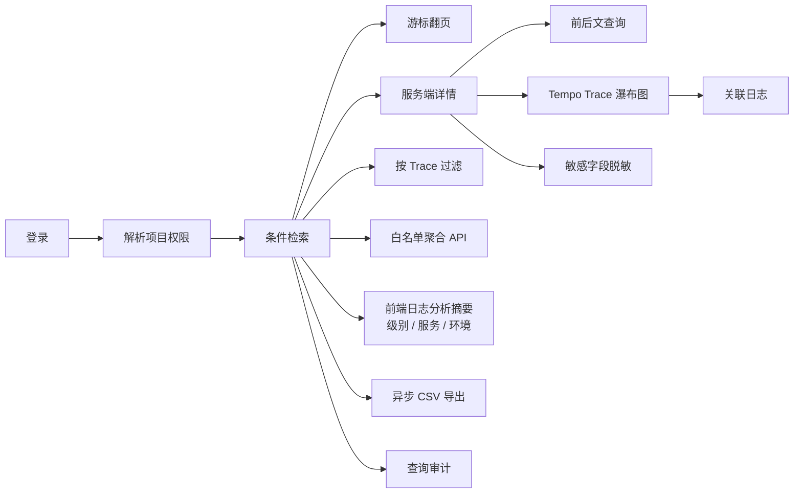

# 日志平台功能架构图

> 版本：v1.4（P0 生产闭环代码、观测栈联调资产、FinOps 只读投影和 DLT 运维基线已交付）
>
> 本图区分“代码已实现”“清单可部署”和“真实环境待验证”。Kafka、Elasticsearch、MySQL 仍是单节点基线；Redis 已用于多副本会话/限流开关，但当前清单只有单副本，不代表 Redis HA。

## 1. 功能分层

```mermaid
flowchart TB
    subgraph Client[客户端与日志源]
        APP[业务应用 JSON 日志]
        AGENT[Fluent Bit / Vector]
        BROWSER[Vue 日志工作台]
    end

    subgraph Edge[接入与安全边界]
        LIMIT[请求体硬限制]
        TOKEN[全局兼容 Token / 项目独立 Token]
        AUTH[Session + CSRF + BCrypt]
    end

    subgraph Backend[Spring Boot 模块化单体]
        INGEST[采集 API]
        PRODUCER[Kafka Producer\n等待 broker ack]
        CONSUMER[批量 Consumer\nNormalize + Stable ID]
        WRITER[ES Bulk create\n幂等 409]
        ACL[项目 ACL]
        QUERY[查询服务\n时间窗 / 白名单 / search_after]
        REDACT[字段脱敏]
        AUDIT[查询审计]
        ADMIN[管理员项目配置\nToken 轮换]
        EXPORT[异步导出 Worker\n有界队列 / CSV / 过期下载]
        FINOPS[Budget Audit Consumer\nSchema 校验 + 独立投影]
        DLT[DLT 状态 / 单条安全重放]
        TRACE[Trace 联查\nTempo + 日志 ACL]
        METRICS[Actuator / Micrometer\nPrometheus 指标]
    end

    subgraph Storage[数据与元数据]
        KAFKA[(Kafka logs.raw\nlogs.raw.DLT)]
        ES[(Elasticsearch Data Stream\n7 天 ILM)]
        MYSQL[(MySQL 用户 / 项目 / 授权 / 审计)]
        REDIS[(Redis Session / 分布式限流\n单副本部署基线)]
        FINOPS_ES[(finops-budget-audit-v1\n只读审计投影)]
        TEMPO[(Tempo / Loki / Prometheus)]
    end

    subgraph Ops[部署与运维基线]
        HPA[HPA / PDB / NetworkPolicy]
        PROM[Prometheus / Grafana 接入点]
    end

    APP --> AGENT --> KAFKA
    APP --> INGEST
    BROWSER --> AUTH --> QUERY
    INGEST --> LIMIT --> TOKEN --> PRODUCER --> KAFKA
    KAFKA --> CONSUMER --> WRITER --> ES
    KAFKA -. finops.budget-audit.v1 .-> FINOPS --> FINOPS_ES
    FINOPS -. 非法事件 .-> KAFKA
    AUTH --> MYSQL
    ACL --> MYSQL
    QUERY --> ACL
    QUERY --> ES
    TRACE --> ES
    TRACE --> TEMPO
    QUERY --> REDACT --> BROWSER
    QUERY --> AUDIT --> MYSQL
    ADMIN --> TOKEN
    ADMIN --> MYSQL
    QUERY --> EXPORT
    EXPORT --> ES
    EXPORT --> REDACT
    AUTH -. SESSION_STORE_TYPE=redis .-> REDIS
    LIMIT -. distributed-rate-limit=true .-> REDIS
    INGEST -.-> METRICS
    CONSUMER -.-> METRICS
    QUERY -.-> METRICS
    METRICS --> PROM
    DLT --> KAFKA
    DLT --> AUDIT
    HPA -. resources/metrics .-> Backend
```

## 2. 用户功能闭环



## 3. 功能状态

| 功能 | 当前实现 | 验证方式 |
|---|---|---|
| JSON HTTP 采集 | 已实现，Kafka broker ack 后返回 202 | 单元测试 + MockMvc |
| 项目 Token | 已实现，数据库只存 SHA-256 摘要，可管理员轮换 | 单元测试与 SQL 静态检查 |
| Kafka 消费 | 已实现，批量归一化、稳定 ID、ES create、409 幂等 | 单元测试 |
| 查询 ACL | 已实现，搜索、详情、上下文、聚合统一注入项目范围 | 服务测试 + MockMvc |
| 查询保护 | 已实现，时间窗、页大小、并发、分钟限流、请求体限制 | 配置和单元测试 |
| 字段脱敏 | 已实现，详情和列表递归遮盖凭据字段 | 单元测试 |
| 查询审计 | 已实现，记录用户、操作、结果、项目和耗时 | H2 启动测试 |
| 前端详情/上下文 | 已接入详情和上下文接口 | 前端生产构建 |
| 前端日志分析摘要 | 已接入级别、服务、环境三组白名单聚合，聚合失败不影响主查询 | 前端生产构建；真实 ES 聚合待验证 |
| 异步日志导出 | 已实现有界线程池、ACL/时间窗复用、脱敏 CSV、10,000 行/50 MiB 上限和任务过期 | 后端编译测试；真实 ES 大数据量待验证 |
| Actuator/Prometheus 指标 | 已实现 HTTP RED、入口、消费、Bulk、查询、导出、消息传播和 Trace 完整率指标 | Spring Context 测试；Prometheus 抓取待验证 |
| Redis Session/分布式限流 | 已实现显式开关，默认内存仓库；K3s 注入 Redis URL 并开启共享限流 | 测试默认不连 Redis；Redis 连通性和 HA 待验证 |
| PDB/HPA/NetworkPolicy | 已纳入 K3s 清单，可部署基线 | metrics-server、监控命名空间和多副本行为待验证 |
| API/Consumer 解耦 | 已实现 API 与 Consumer 独立 Deployment，Consumer 不暴露业务 Service | 多副本 Kafka 分区扩展和滚动升级待验证 |
| Tempo Trace 视图 | 已实现受 ACL 约束的日志/Tempo 联查 API和前端瀑布图；纳秒时间字段按字符串传输并用 BigInt 计算 | 前后端构建通过；真实 Java Agent/Tempo 数据待联调 |
| FinOps Budget Audit 投影 | 已实现独立 Topic 消费、v1 Schema/metadata-only 校验、独立 ES 索引、稳定 ID 幂等和 ACL 查询 | 单元测试通过；真实 FinOps/Kafka/ES 联调待验证 |
| DLT 运维 | 已实现固定 Topic 白名单、单 partition/offset 重放、管理员权限、审计和积压/结果指标 | 边界单元测试；真实 Kafka 重放与幂等核对待验证 |
| OTel/Tempo/Loki/Prometheus | 已提供 Collector、Compose 联调栈、Grafana 数据源、告警规则和 Smoke Test | 配置/脚本静态验证通过；目标环境抓取与通知链路待验证 |
| 生产 HA 参考与门禁 | 已提供 Strimzi Kafka、ECK ES、Redis HA values 和部署门禁；默认 K3s 清单仍为单节点联调基线 | 真实集群、故障演练、备份恢复与容量压测 |
