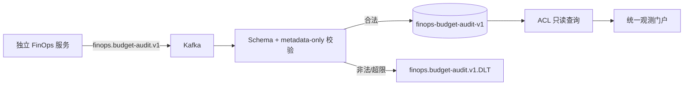

# P0 生产闭环设计与交付

状态：日志平台 P0 代码和部署基线已落地，真实基础设施联调与容量门禁需在目标集群执行。

## 1. 职责边界

本项目只负责统一观测数据面：日志采集、Trace/Request 关联、检索、审计、告警和 FinOps
预算审计事件的只读投影。它不负责 Token 计算、成本核算、Usage Ledger、Price Book、预算
预占或模型调用前决策。

独立 FinOps 服务负责发布 `finops.budget-audit.v1`。日志平台消费该 Topic 后，仅以独立
索引 `finops-budget-audit-v1` 保存可检索的审计元数据。预算审计事件必须符合
[`budget-audit-event-v1.schema.json`](../ingest/budget-audit-event-v1.schema.json)，禁止携带
Prompt、Completion、工具参数和凭据。

## 2. P0 交付项

| 交付项 | 实现 | 生产门禁 |
|---|---|---|
| OTel/Tempo/Loki/Prometheus 观测栈 | Compose、Collector、健康检查、Prometheus 规则、Grafana 数据源 | `deploy/observability/smoke-test.sh` + 真实 Collector/Tempo 联调 |
| FinOps 审计只读投影 | Kafka consumer、Schema 校验、独立 ES 索引、ACL 查询 API | FinOps Topic ACL、租户映射和消息重放演练 |
| DLT 运维 | 固定 Topic/分区/offset 单条重放、管理员权限、查询审计、积压指标 | 根因修复后重放、幂等和审计核对 |
| Trace 门户 | 日志详情内 Trace 瀑布图、Span 与日志关联 | Java Agent/SDK 真实 Span + Tempo 数据 |
| 生产部署门禁 | OTel、FinOps 审计 Topic、索引模板和 DLT 初始化资产 | 生产环境必须使用 HA Operator/受管服务 |
| 容量验收 | 入口负载工具、验收矩阵和指标清单 | 450 EPS 持续、600 EPS 突发、24 小时稳定性 |

## 3. 预算审计事件流程

日志平台不得根据审计事件重新计算成本，不得回写 FinOps Ledger，也不得根据审计事件执行
预算拦截。FinOps 不可用时日志采集主链路保持 fail-open。

## 4. DLT 安全约束

- 只允许 `logs.raw.DLT` 和 `finops.budget-audit.v1.DLT`。
- 只允许单条消息、指定分区和 offset 重放。
- 目标 Topic 只能由 DLT 名称推导，客户端不能指定任意目标 Topic。
- 重放不提交 DLT offset，源消息保留以便审计和再次处理。
- 每次成功或失败都写入 `log_query_audit`，Prometheus 暴露成功/失败计数。

## 5. 验收标准

1. 预算审计合法事件可以进入独立索引，普通项目用户只能检索授权项目。
2. 携带 Prompt、Completion、凭据、错误版本或超大正文的事件进入 DLT。
3. 同一个事件 ID 重复消费不会产生重复投影。
4. Tempo、Loki、Prometheus 任一不可用时，日志 Kafka/ES 主链路仍可用。
5. DLT 单条重放受管理员权限、Topic 白名单和审计约束。
6. 真实环境完成 Kafka、ES、Redis、OTel、Tempo、Loki、Prometheus 的集成测试后，才可将
   `FINOPS_BUDGET_AUDIT_CONSUMER_ENABLED` 和 `OTEL_ENABLED` 设为 `true`。

## 6. 尚需外部环境完成的门禁

P0 代码和部署资产不等于生产认证。Kafka 三副本、ES 多节点/TLS/Snapshot、MySQL HA、Redis
HA、Alertmanager 通知、真实压测、故障演练和备份恢复必须在目标集群完成。当前 K3s Kafka/ES 双实例清单
仍只作为开发和联调基线。
