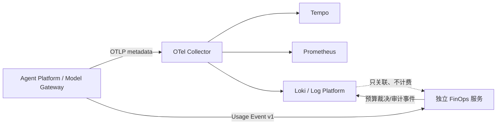

# 统一可观测平台与独立 FinOps 边界

状态：Phase 0 基础契约已落地，FinOps 外部连接默认关闭。

## 目标

`log-platform-ai` 作为统一可观测平台，负责日志采集、规范化、Trace 关联、检索、审计和
Prometheus/Loki/Tempo 的信号接入。它不负责 Token 计算、Provider 成本核算、预算预占、预算
结算或模型调用前拦截。

独立 FinOps 服务负责 Usage Ledger、Price Book、成本核算、Budget Policy、Reservation 和
预算审计。Agent Platform 负责产生物理模型调用的 Usage Event，并按冻结的事件契约调用 FinOps。

## 代码边界

- `TelemetryContext` 是跨信号的关联元数据，不包含 Prompt、Completion、工具参数、凭据或正文。
- `TelemetryEventChannel` 明确区分 `LOGS`、`AI_USAGE`、`BUDGET_AUDIT`，防止把 Usage 或 Budget
  事实写入日志索引后再反推财务数据。
- `TelemetryContextFilter` 负责 HTTP 入口的 W3C `traceparent` 校验、请求/Trace 关联头和 MDC；
  它不承担认证授权，也不接受客户端 `tenant_id` 覆盖服务端身份。
- `FinopsIntegrationProperties` 只提供 `DISABLED`、`SHADOW`、`ACTIVE` 开关和独立通道配置；
  当前日志平台没有预算 Gate、Ledger 或价格计算 Bean。

## 默认安全策略

1. OTel OTLP 默认关闭，开启后发送失败由异步 SDK/Collector 隔离，不能阻塞日志 Kafka/ES 主链路。
2. FinOps 集成默认 `DISABLED`、`fail-open=true`、`metadata-only=true`。
3. Prometheus 指标只允许低基数标签，禁止租户、请求、运行、用户和会话 ID 作为标签。
4. 客户端提供的 `traceparent` 只能提供关联线索；日志项目权限仍由服务端 Token/Session/ACL 决定。

## 分阶段实施

### 已完成的第一批基础改造

- HTTP W3C Trace Context 兼容层和响应关联头；
- 统一 `TelemetryContext`/事件通道枚举；
- Micrometer Tracing + OTLP 可选依赖和采样配置；
- Collector traces/metrics/logs 管线、错误/慢请求尾采样和健康端点；
- K3s 可选 Collector 部署清单。

### 后续门禁

- 完成真实 Tempo/Loki/Prometheus 联调和 Collector 故障演练；
- 由 Agent Platform 冻结并发布 Usage Event v1、Budget Decision v1 后，再启用 `SHADOW`；
- 在独立 FinOps 服务完成幂等 Ledger、租户映射和审计验证后，才允许 `ACTIVE`；
- 日志平台永远不从日志、Trace 或 Metric 反推成本，也不把 FinOps 故障转换为日志接入失败。
