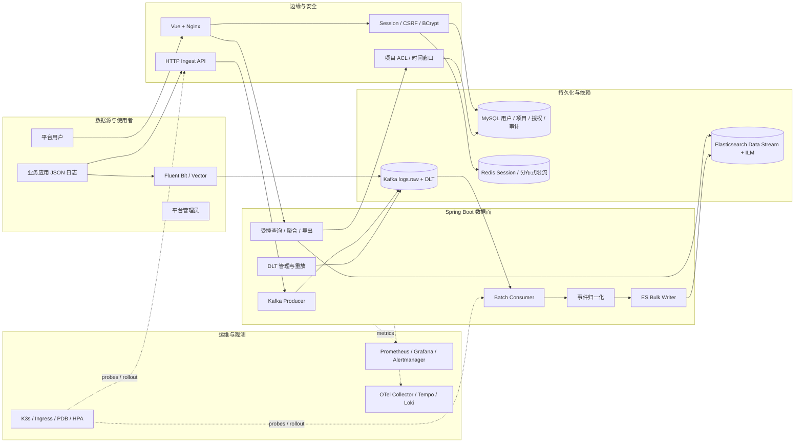
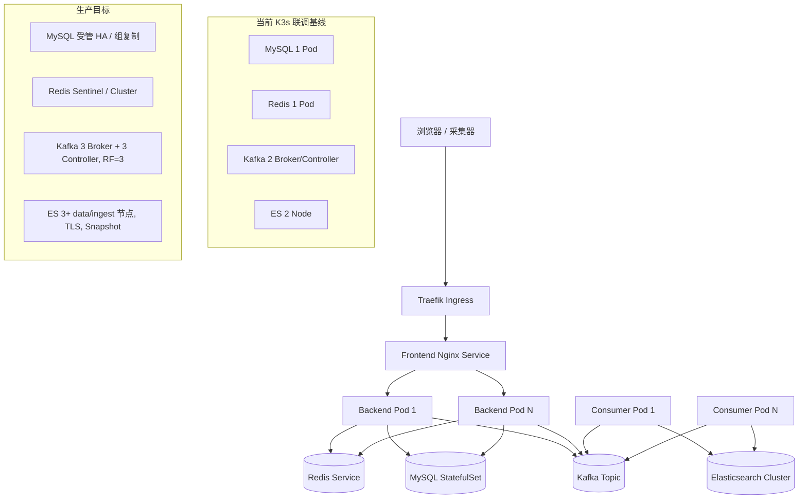
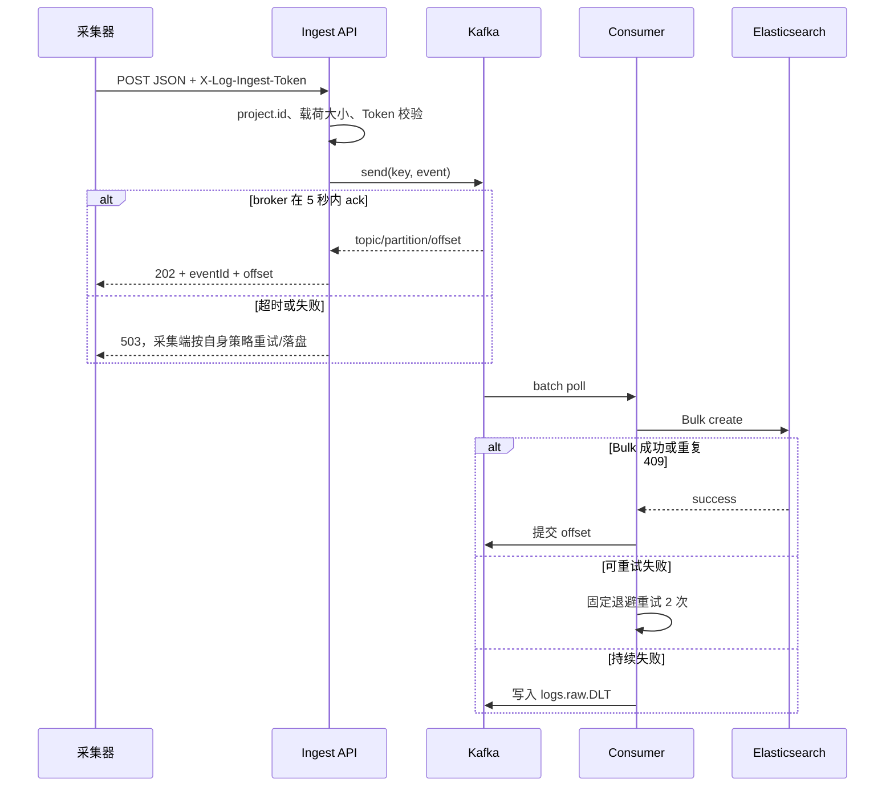
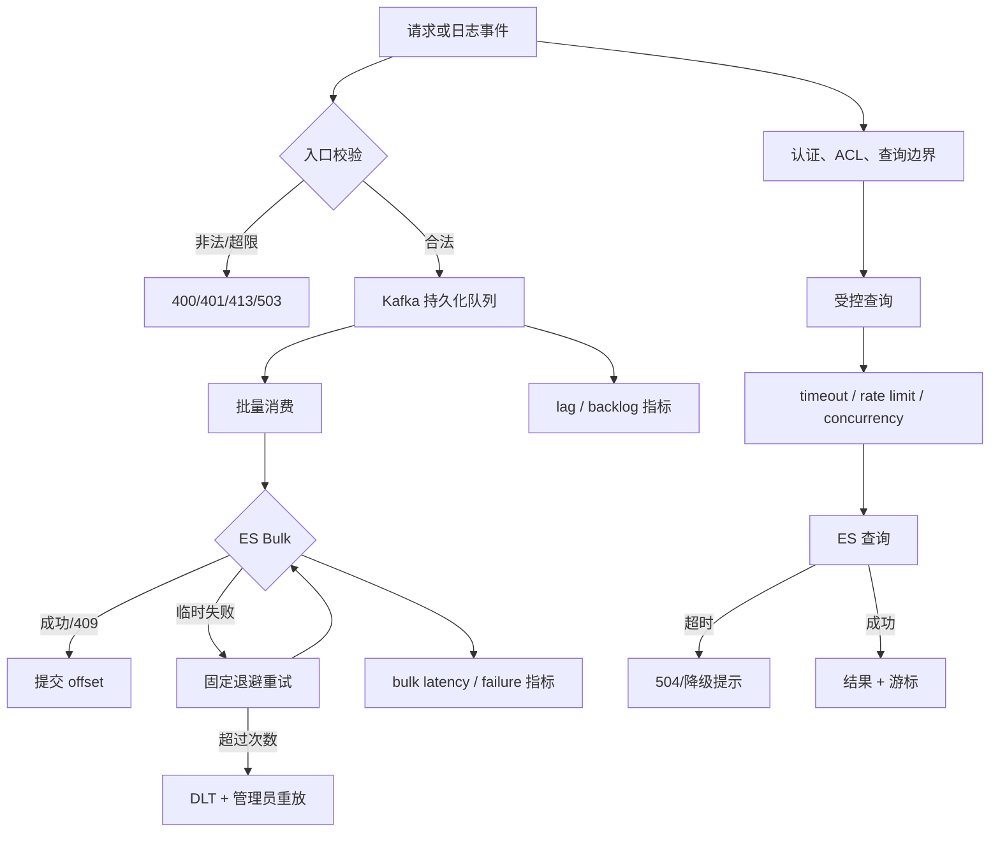

# 案例一：日志平台系统稳定性与高可用设计

> 用途：面试讲解与技术追问准备。本文以仓库在 2026-10-10 前可见的代码、配置和 K3s 清单为事实基线；“已实现”“基线”“生产目标”严格区分，不把设计目标描述成线上事实。

## 1. 面试中的一句话定位

我把日志平台拆成“接入面、消息缓冲面、处理面、查询面、存储面和运维面”，用 Kafka 将采集和 Elasticsearch 解耦，用 at-least-once 消费加稳定事件 ID 保证可重放，用 Redis Session/限流、K3s 滚动发布、PDB、探针和指标告警保护 API。当前仓库已经具备可运行的双实例联调基线；真正生产 HA 还需要把 Kafka、ES、MySQL、Redis 和观测系统切换到奇数节点/受管 HA，并完成备份恢复与故障演练。

这句话里包含三个重要边界：

1. **稳定性优先保证“不丢、不越权、不拖垮”**，不追求所有请求都同步成功。
2. **高可用是分层的**：应用副本可用不等于 Kafka、MySQL、Redis、ES 全部可用。
3. **当前状态可诚实说明**：K3s 清单是基线，不等于已经证明了 SLA。

## 2. 业务问题与设计目标

### 2.1 业务场景

平台接收多个项目的 JSON 日志，支持按时间、项目、服务、Trace、错误和关键字检索，并提供上下文、聚合、导出和 DLT 重放。日志是高写入、追加为主、短周期保存的数据；故障期间允许查询短暂不可用，但不能因为 ES 短暂故障直接丢掉已接收日志，也不能因为一个项目故障泄露另一个项目的数据。

### 2.2 可靠性目标

下表是设计目标和当前实现的对照。没有压测或演练证据的指标，只作为验收目标。

| 目标 | 设计要求 | 当前实现/状态 |
|---|---|---|
| 入口可用 | API 多副本、滚动升级无中断、健康探针摘除坏实例 | 后端 Deployment、滚动策略、PDB、探针已具备；默认副本数可为 1 |
| 接收不丢 | 入口收到 Kafka broker ack 才返回 202；Kafka 持久化后可重放 | `LogIngestService` 已实现；Fluent Bit 直写 Kafka 仍需按部署配置验证 |
| 写入可恢复 | ES 失败重试，超限进入 DLT，人工/自动重放 | 固定退避 2 次 + DLT 已实现 |
| 消费幂等 | 重复消费不会产生重复文档 | `project.id + event.id` SHA-256 作为 ES `_id`，`create` 的 409 视为成功 |
| 会话连续 | API 多副本不依赖本地 Session | Redis Session 开关和 K3s 配置已具备；Redis 当前基线为单副本 |
| 查询保护 | 时间窗口、页大小、并发、频率、聚合规模由后端强制 | 已实现；Redis 分布式限流可开关 |
| 访问隔离 | 每次搜索、详情、上下文、聚合均应用项目 ACL | 已实现，未授权项目 fail closed |
| 可观测 | 能看到接入拒绝、Kafka lag、Bulk 失败、查询 P95、DLT | Micrometer/Prometheus 指标与规则已提供，真实监控联调待验收 |
| 生产 HA | Kafka/ES/MySQL/Redis 具备节点故障容忍和恢复演练 | 生产 Operator 参考清单已提供，尚未作为当前 K3s 默认拓扑 |

### 2.3 非目标

- 日志平台不负责业务事务提交，不向业务应用承诺“写入 ES 后才返回”。
- 不用数据库保存每条日志；MySQL 只保存用户、项目、授权和审计。
- 不开放任意 Elasticsearch DSL；查询能力必须在平台边界内。
- 不把 Tempo、Loki 或 FinOps 的故障传导为日志接入故障。

### 2.4 我的设计过程

面试时建议按下面的顺序讲设计，而不是先报组件名称：

1. **先画边界**：日志接入、日志查询、用户/项目权限、Trace 联查、FinOps 审计分别由谁负责；明确日志平台不拥有成本账本和业务事务。
2. **再列故障**：入口超时、Kafka Broker 故障、ES 不可用、单条坏消息、查询风暴、Session 丢失、权限库不可用、节点驱逐分别会造成什么后果。
3. **定义数据语义**：入口 202 只表示 Kafka ack；消费采用 at-least-once；`project.id + event.id` 是幂等边界；失败消息进入 DLT；查询超时返回 504/降级。
4. **按故障选择隔离层**：Kafka 负责写入削峰，API/Consumer 分部署，查询有并发闸门，ES 失败不阻塞入口，DLT 隔离坏消息，Redis 共享多副本状态。
5. **再做依赖 HA**：应用用 K3s Deployment/PDB/HPA；Kafka 用奇数 Controller 和副本；ES 用多 data 节点和 Snapshot；MySQL/Redis 使用受管 HA。
6. **最后补运维闭环**：探针、指标、告警、备份、恢复、滚动升级和故障演练必须能验证前面的假设。

这种顺序能回答面试官常问的“为什么需要 Kafka/Redis/ES，而不是因为大家都在用这些组件”：组件只是承载设计语义，先有边界和失败模型，再有技术选型。

## 3. 总体架构

### 3.1 逻辑架构图



### 3.2 部署拓扑与现实边界



当前 K3s 清单的关键事实：

- API 和 Consumer 已拆成两个 Deployment，共享 `logs-es-writer` consumer group；API 默认不消费，Consumer 专注 Kafka -> ES。
- 后端可通过 `SESSION_STORE_TYPE=redis` 和 `LOG_QUERY_DISTRIBUTED_RATE_LIMIT=true` 使用 Redis 共享状态。
- K3s 基线是 Kafka 2 节点、Topic 副本因子 2、ES 2 节点；两个 KRaft controller 不能容忍单节点故障后继续选主。
- MySQL 与 Redis 基线各 1 个 Pod；ES 基线关闭内置安全，仅适合内网联调。
- `deploy/k3s/production` 提供 Strimzi、ECK 和 Redis Sentinel 参考清单，生产拓扑必须通过门禁和演练后再切换。

## 4. 稳定性设计的分层思路

### 4.1 入口层：快速失败、有限等待、明确语义

HTTP 入口只做四件事：校验 JSON 对象、校验 1 MiB 载荷上限、校验项目 Token、投递 Kafka。它不在 Web 请求线程写 ES。



这里的关键语义是：**202 表示 Kafka 已确认，不表示 Elasticsearch 已可查**。这个语义把入口可用性和下游恢复能力解耦，也让客户端可以根据 offset 追踪接收结果。

### 4.2 消息层：持久化、复制、可重放

当前生产配置方向：`acks=all`、生产幂等、LZ4 压缩、关闭自动提交、`read_committed`。生产目标拓扑使用 3 Broker、RF=3、`min.insync.replicas=2`，避免只剩一个副本时仍错误地确认写入。

需要区分两个故障目标：

- **Broker 短暂故障**：生产者重试，业务入口返回 503 或由采集器本地磁盘缓冲，Kafka 恢复后继续接收。
- **消费端/ES 故障**：Kafka lag 增长但数据保留，Consumer 恢复后继续处理；超过重试上限的消息落 DLT，不阻塞整个分区。

### 4.3 处理层：至少一次 + 幂等

Consumer 正常返回后监听容器才提交 offset。进程在 ES 成功后、offset 提交前崩溃，会再次消费同一消息；因此写入必须幂等：

```text
document_id = SHA-256(project.id + "\\0" + event.id)
ES operation = create
409 Conflict = already written = success
```

这比覆盖式 `index` 更适合重放：重复事件不会悄悄覆盖可能已经被修正的文档，跨项目相同 `event.id` 也不会冲突。

### 4.4 查询层：保护下游比追求单次成功更重要

查询服务在发起 ES 请求前强制：

- 普通用户只能查当天，管理员最多 168 小时。
- `size <= 500`，固定按 `@timestamp desc, event.id desc` 排序，用 `search_after` 游标。
- 聚合字段白名单，最多三层，每层最多 100 个 bucket。
- 单用户/IP 每分钟默认 120 次，全局并发默认 20；Redis 打开后使用跨实例分钟窗口。
- ES 查询 timeout 3 秒，HTTP read timeout 5 秒；明确识别 `timed_out` 并返回可重试错误。
- 详情也通过受权限窗口约束的 `_search`，不允许按文档 ID 直接绕过 ACL。

设计原则是“查询可降级，写入不能静默丢”：ES 慢时返回 429/504，让用户收窄范围；不允许无限重试把 API 线程池和 ES 查询线程池一起拖死。

### 4.5 会话和权限层：多副本下保持一致

- 登录使用服务端 `JSESSIONID`、BCrypt cost 12、Session Fixation 防护和 Cookie CSRF Token。
- 多副本部署必须把 Spring Session 切到 Redis；本地 Map Session 只适合单实例开发/测试。
- 项目权限每次从服务端登录态和 MySQL 关系解析；普通用户无项目时拒绝请求，指定越权项目返回 403。
- 采集接口不依赖浏览器 Cookie，使用全局兼容 Token 或项目独立 Token，并通过常量时间比较降低时序攻击风险。

### 4.6 应用发布层：故障实例自动摘除

K3s Deployment 使用 `RollingUpdate(maxUnavailable=0,maxSurge=1)`，配合 startup/readiness/liveness 探针：

- startup 未通过时不接流量，避免慢启动期间被探活误杀。
- readiness 失败时 Service 摘除实例，已有 Kafka/ES 连接异常不会继续承接请求。
- liveness 失败时重启进程，恢复死锁或连接池异常。
- PDB 保证维护/驱逐时保留最少可用 Pod；HPA 按 CPU/内存扩缩，但生产还应增加 Kafka lag、请求延迟等业务指标。

注意：PDB 不能创造节点容量；如果所有 Pod 在同一个 K3s 节点，节点故障仍会整体不可用，生产需配合 topology spread/反亲和和多节点存储。

### 4.7 存储层：生命周期、容量和恢复

- ES 使用 Data Stream、受控 mapping、`dynamic=false` 和 7 天 ILM，减少字段爆炸与无限增长。
- Kafka 保留 48 小时，给 ES 故障和人工重放留下窗口。
- 生产 ES 目标为至少 3 个 data/ingest 节点、TLS、认证、Snapshot；当前 2 节点基线只代表联调可运行。
- MySQL 必须使用受管 HA/组复制，并演练备份恢复；应用账号不能使用 root。
- Redis 既保存 Session 又可保存限流计数，生产使用 Sentinel/Cluster，Session 与限流最好使用独立命名空间和 ACL。

## 5. 故障处理矩阵

| 故障 | 用户可见现象 | 自动保护 | 恢复动作 | 目标口径 |
|---|---|---|---|---|
| 单个 API Pod 挂掉 | 少量请求重试 | readiness 摘除、Deployment 重启、其他副本继续服务 | 检查启动日志、错误率和 HPA | 目标 RTO < 1 分钟；需演练验证 |
| API 滚动发布 | 连接可能短暂重试 | `maxUnavailable=0`、PDB、Session 共享 | 失败版本回滚 | 发布不主动中断可用副本 |
| Kafka Broker 短暂故障 | 入口 503 或采集器本地缓冲 | `acks=all`、生产重试、RF/ISR | 恢复 Broker，确认 lag 回落 | 已确认消息不丢；RPO 取决于副本确认 |
| ES 不可用 | 新日志暂不可查，查询 503/504 | Kafka 保留、Consumer 重试、DLT | 恢复 ES，再消费积压/重放 DLT | 不以 ES 可用性阻断入口 |
| 单条脏消息 | 某分区持续失败风险 | 有界重试后 DLT，避免无限阻塞 | 修复数据/代码后按 offset 重放 | 失败可定位、可审计 |
| Redis 不可用 | 登录态或分布式限流失败 | 生产配置下应 fail closed；日志入口不依赖 Redis | 恢复 Redis 或临时切回受控单实例模式 | 不允许跨实例 Session 不一致 |
| MySQL 不可用 | 登录/ACL/审计异常 | 查询无法解析权限时 fail closed；审计尽力而为 | 恢复数据库/切换副本 | 越权不能因 DB 故障发生 |
| 查询风暴 | 查询返回 429/504 | 用户/IP 限流、全局 Semaphore、ES timeout | 降低导出/聚合并发，定位慢查询 | 写入链路与查询链路资源隔离 |
| 节点/机架故障 | 相关 Pod 重调度 | 多副本、PDB、节点反亲和、持久卷 | 检查副本、重平衡和磁盘 | 依赖生产拓扑，当前基线未承诺 |

## 6. 功能设计图：从故障到控制点



这个图体现我的设计能力不在于堆组件，而在于为每个失效点安排边界：入口拒绝、队列吸收、消费重试、DLT 隔离、查询限流、ACL fail closed 和指标闭环。

## 7. 设计原则、优点与代价

### 7.1 设计原则

1. **先定义失败语义，再选中间件**：202、503、429、504、DLT 都有明确含义。
2. **数据面和控制面分离**：日志写入不依赖查询、Tempo 或 FinOps；管理接口不直接修改日志。
3. **每个重试都必须有边界**：重试次数、等待时间、保留窗口和重放范围都可控。
4. **权限在服务端闭环执行**：不能相信前端传来的 `admin`、项目列表或 DSL。
5. **可恢复优先于“看起来成功”**：宁可返回 503/429，也不返回假成功或静默丢数据。

### 7.2 优点

- Kafka 将入口和 ES 解耦，ES 故障时可以积压和重放。
- 稳定 ID + `create` 将 at-least-once 变成业务上可接受的幂等写入。
- API/Consumer 分离，查询请求不会和写入批处理竞争同一进程资源。
- 后端硬限制和 ACL 统一收口，能同时控制资源风险和数据越权。
- Data Stream + ILM 控制日志生命周期，容量增长可估算。

### 7.3 代价与取舍

- 202 之后有“已接收但暂不可查”的可见延迟，产品必须展示或解释这一语义。
- at-least-once 仍可能重复执行归一化和 Bulk，需要幂等键；严格 exactly-once 会引入事务/性能复杂度。
- Redis、Kafka、ES 增加运维成本；但日志平台的故障隔离和重放价值高于直连方案的简单性。
- 当前 Session/限流可单机运行，但多副本必须引入 Redis；Redis 本身成为需要 HA 的依赖。
- 同时追求强顺序和高吞吐会受 Kafka 分区约束，key 设计需要按业务容忍度取舍。

## 8. 当前缺口与生产演进路线

### P0：上线前必须完成

1. Kafka 从 2 节点改为至少 3 Broker/Controller，RF=3、`min.insync.replicas=2`、TLS/SASL、Topic ACL。
2. ES 使用 ECK 或受管集群，至少 3 个 data/ingest 节点，TLS/认证、Snapshot、恢复演练。
3. MySQL 使用受管 HA/组复制，验证应用账号、备份、恢复和 schema 迁移。
4. Redis 使用 Sentinel/Cluster 或受管 Redis，验证 Session 迁移、节点故障和限流一致性。
5. 所有采集入口、Kafka lag、ES Bulk、查询 P95、DLT、磁盘水位接入 Prometheus/Alertmanager。
6. 做滚动发布、Kafka 分区故障、ES 不可用、Redis 切主、MySQL 恢复、网络分区演练。

### P1：规模增长后

- HPA 增加业务指标：Kafka lag、HTTP 入口延迟、查询排队数，而不只看 CPU/内存。
- Consumer 增加实例和 listener 并发，确保不超过 Topic 分区数；必要时预留 12 分区。
- 导出任务从 JVM 内存 Map 迁移到持久化队列 + 对象存储，支持多副本和断点恢复。
- 查询使用 PIT + `search_after` 保持长分页快照；缓存固定聚合或建设预聚合索引。
- 增加项目级配额、独立限流、字段脱敏策略和告警通知。

## 9. 验证与验收方案

### 9.1 自动化测试

- 单元：`LogIngestServiceTest`、`ElasticsearchLogWriterTest`、`LogQueryServiceTest`、`ProjectAuthorizationServiceTest`、`LogQueryLimiter` 相关测试。
- 集成：Kafka Testcontainer + ES Testcontainer，验证 ack、批量、offset、409 幂等、部分失败和 DLT。
- 安全：普通用户无项目、越权项目、详情旁路、CSRF、Token 轮换、管理员权限。

### 9.2 故障演练

1. 停 ES 5 分钟，确认入口按 Kafka ack 返回、lag 增长、没有静默丢失；恢复后积压回落。
2. 在 ES 成功后、offset 提交前杀 Consumer，确认重复消息最终只有一个文档。
3. 停 Redis 主节点，确认 Session 行为、限流错误语义和切主时间。
4. 滚动升级 API，检查 PDB、readiness 和客户端错误率。
5. 注入单条不可写事件，确认固定重试后进入 DLT，重放范围仅限指定 Topic/partition/offset。

### 9.3 关键验收指标

| 指标 | 建议目标 | 说明 |
|---|---:|---|
| 接入确认成功率 | >= 99.9%（依赖 Kafka 可用） | 统计 202 与 503，排除非法请求 |
| Consumer lag 恢复 | 故障恢复后 5 分钟内持续下降 | 目标值按真实 EPS 校准 |
| 重复写入 | 同 `project.id + event.id` 文档数 = 1 | 用杀进程/重放验证 |
| 查询 P95 | 普通 24 小时 < 2s，管理员 7 天 < 5s | 需真实日志压测 |
| DLT 可追溯性 | 每条可定位原 Topic/partition/offset | 需保留 headers 和审计记录 |
| 恢复目标 | 明确 RTO/RPO 并演练 | 不能只写在文档里 |

## 10. 面试深挖问答

### Q1：为什么不让 HTTP 直接写 ES？

因为入口吞吐会和 ES 写入能力强耦合。ES 慢、GC 或分片迁移时，HTTP 线程会被占满，采集端重试又会放大流量。Kafka 提供持久化缓冲、削峰、重放和消费端独立扩容；入口只等待 broker ack，故障边界清晰。

### Q2：你能保证不丢日志吗？

准确说是“在 Kafka broker 持久化确认后不静默丢”。入口失败返回 503，客户端/Fluent Bit 需要本地重试或磁盘缓冲；Kafka 到 ES 采用 at-least-once，失败消息重试或进 DLT。若 Kafka 集群、所有副本和采集端本地缓冲同时损坏，任何系统都不能无条件保证不丢，所以要用 RF、快照和演练定义 RPO。

### Q3：为什么两个 Kafka 节点不算生产 HA？

当前 KRaft controller 只有两个，单节点故障后没有多数派继续选主。生产至少三 controller 才能容忍一台故障；同时 RF=3、`min.insync.replicas=2` 才能在副本确认和可用性之间取得可解释的平衡。

### Q4：API 多副本后为什么还要 Redis？

因为 Session 和限流计数如果放在 JVM 内存，每个副本看到的状态不同：用户可能登录到 Pod A，却被 Pod B 判定未登录；限流也能被绕过。Spring Session Redis 共享会话，Redis 计数提供跨实例配额。Redis 必须做 HA，否则它会成为新的单点。

### Q5：为什么不追求 exactly-once？

端到端 exactly-once 要求消息、消费状态和 ES 写入具备跨系统事务，成本高且不适合当前规模。日志是追加事件，使用 at-least-once + 业务唯一键幂等，能把重复副作用压成 0，同时保留重放能力，复杂度和可恢复性更合理。

### Q6：ES 挂了为什么不让 Consumer 无限重试？

无限重试会卡住分区，后续消息全部无法处理，也无法区分短暂故障和坏消息。有限退避后进入 DLT，Kafka 主链路继续消费其他分区；恢复后由管理员按根因修复和 offset 范围重放。

### Q7：你如何证明设计有效？

不是只看代码覆盖率，而是组合验证：单元测试验证边界，Testcontainer 验证 Kafka/ES 交互，压测验证 EPS、lag、Bulk P95 和查询 P95，故障演练验证杀 Pod、停 ES、切 Redis、重放 DLT，并将 RTO/RPO 和告警阈值归档。

## 11. 代码与配置证据索引

- 入口确认语义：`log-platform-ai-admin/src/main/java/com/zhouyi/admin/service/LogIngestService.java`、`LogIngestController.java`
- 批量消费和 offset 语义：`log-platform-ai-admin/src/main/java/com/zhouyi/admin/service/LogKafkaConsumer.java`
- ES 幂等 Bulk：`log-platform-ai-admin/src/main/java/com/zhouyi/admin/service/ElasticsearchLogWriter.java`
- Kafka producer/consumer、固定退避、DLT：`log-platform-ai-admin/src/main/java/com/zhouyi/admin/config/LogIngestConfiguration.java`
- 查询边界与超时：`LogQueryService.java`、`LogQueryLimiter.java`、`LogQueryProperties.java`
- 项目 ACL：`ProjectAuthorizationService.java`
- Redis Session 开关：`SessionStoreConfiguration.java`、`application.yml`
- K3s 应用拆分、PDB、HPA、NetworkPolicy：`deploy/k3s/manifests/40-backend.yaml`、`41-consumer.yaml`、`45-backend-availability.yaml`
- 生产 HA 参考：`deploy/k3s/production/strimzi-kafka.yaml`、`eck-elasticsearch.yaml`、`redis-ha-values.yaml`
- 运行手册和告警：`docs/operations/observability-runbook.md`、`deploy/observability/prometheus-rules.yaml`
