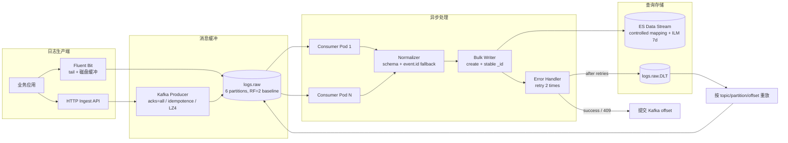
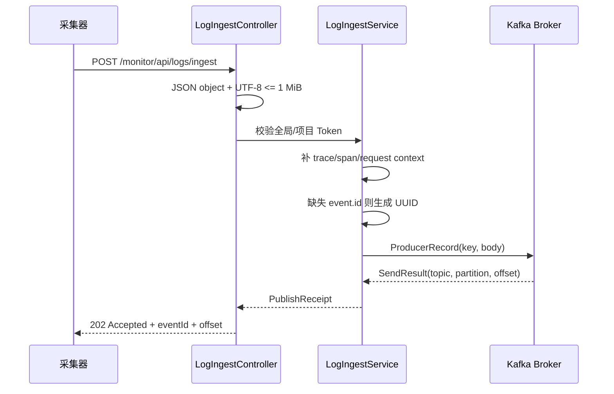
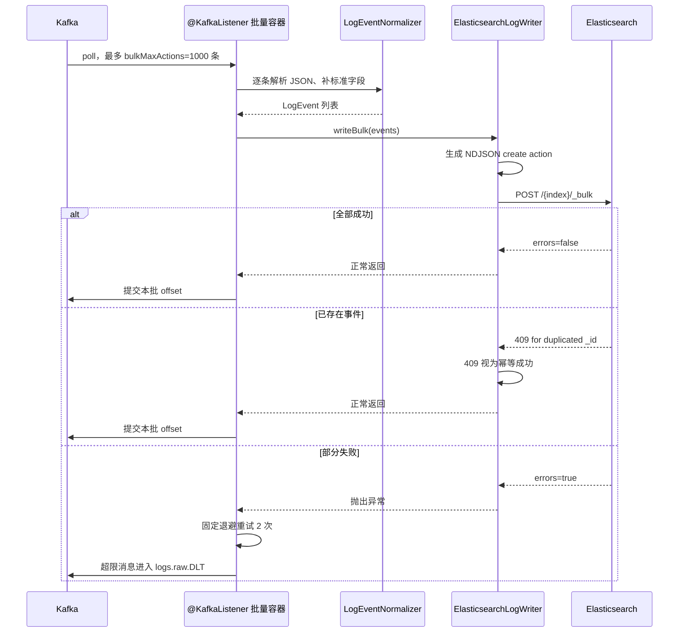

# 案例二：高性能日志写入链路设计

> 选题说明：本案例选择平台最能体现高性能设计能力的功能——“日志从采集入口到 Elasticsearch 的高吞吐、可恢复写入”。它同时覆盖异步化、削峰、批量、分区并行、幂等、重试和背压，比单独讲一个查询 SQL 更能体现系统级设计能力。

## 1. 面试中的一句话定位

我没有让采集请求同步写 Elasticsearch，而是设计成“入口快速校验并等待 Kafka ack，Kafka 负责削峰和顺序，Consumer 批量归一化，ES Bulk 一次写入，稳定事件 ID 解决重复消费，失败进入 DLT”。这样 Web 线程、消息吞吐和 ES 写入可以独立扩展；性能瓶颈可以通过分区、Consumer 并发、Bulk 批量和 ES 节点逐层定位，而不是靠盲目加机器。

## 2. 从问题到指标：为什么需要这条链路

### 2.1 直接写 ES 的问题

如果每条日志在 HTTP 请求中直接调用 ES：

1. 每条事件一次网络往返，连接、序列化和 flush 成本高。
2. ES 任意抖动会直接反映为入口超时，采集端重试产生写入风暴。
3. 入口 QPS 与 ES 写入能力绑定，无法先接收再按消费能力处理。
4. 请求超时发生在“ES 已写入但响应未返回”时，重试会制造重复事件。
5. 没有 Kafka offset 和保留窗口，故障后很难精确重放。

### 2.2 设计目标

| 目标 | 设计口径 |
|---|---|
| 写入吞吐 | 设计峰值 300 EPS，真实上限必须压测校准 |
| 入口延迟 | 不等待 ES，仅等待 Kafka broker ack；目标 p95 < 100ms 需实测 |
| 可靠性 | Kafka ack 后事件可重放；ES 重试有上限，失败进 DLT |
| 重复控制 | Kafka 重复投递/重放后，单项目同事件只保留一个 ES 文档 |
| 扩展性 | 通过 Topic 分区、Consumer 副本、Bulk 批大小横向扩展 |
| 查询隔离 | API 与 Consumer 独立 Deployment，批量写入不占查询线程 |
| 数据治理 | 统一 OTel/ECS 风格字段，受控 mapping 和 7 天 ILM |

## 3. 端到端架构图



### 3.1 扩展公式

Kafka 消费并行上限受分区数限制：

```text
consumer_parallelism <= topic_partitions
partitions >= ceil(EPS_peak / target_eps_per_partition)
```

当前容量模型以单分区 500 EPS 的保守目标估算，300 EPS 峰值至少需要 1 个分区，但为了项目、服务和故障重平衡，Topic 起步 6 分区、RF=2；生产建议 3 Broker、RF=3，并按真实峰值预留到 12 分区。分区数不是越多越好：分区越多，文件句柄、选主、重平衡和运维成本越高。

## 4. 数据流程设计

### 4.1 HTTP 接入流程



入口 key 为：

```text
project.id + "|" + service.name + "|" + deployment.environment
```

这个 key 保证同一项目/服务/环境的相对顺序，同时让不同服务分散到不同分区。key 太粗会导致热点，完全随机又会失去局部顺序；当前方案是在“服务级顺序”和“可并行”之间取平衡。

### 4.2 Consumer 到 ES 流程



`LogKafkaConsumer.consume()` 正常返回之前不提交 offset，因此“处理成功再提交”是这条链路的核心一致性边界。当前 Listener `concurrency=1`，通过 Consumer Deployment 副本扩展同一 consumer group 的分区消费；扩容后实例数不能超过分区数。

## 5. 关键高性能设计

### 5.1 异步化：把最贵的工作移出请求线程

入口只做校验、鉴权、序列化和 Kafka send。ES 归一化、批量构造和网络写入由 Consumer 后台完成。

收益：

- Web 线程占用时间与 ES Bulk 延迟无关，入口能承受短时突发。
- API 和 Consumer 可以使用不同副本数、CPU 和内存。
- ES 故障时 Kafka 形成可观测 backlog，而不是把 API 线程全部堵死。

代价：

- 202 后存在最终可见延迟，产品必须理解“接收”和“可查”是两个状态。
- 客户端需要处理 503 并配合本地重试；平台不能替客户端无限同步等待。

### 5.2 Kafka 分区并行：吞吐的横向扩展轴

Kafka 的顺序追加、页缓存、批量发送和分区并行使它适合作为日志缓冲。一个分区同一时刻由一个 consumer 处理，因此：

- 分区数决定并行上限；Consumer 副本数不能超过分区数。
- key 决定顺序与负载分布；同 key 同分区，不同 key 可并行。
- 扩容分区会改变新消息的 key 路由，可能影响跨分区顺序；生产应提前规划，而不是热点出现后随意加分区。

热点处理策略按业务选择：

1. 要求服务级顺序：保留当前 key，给热点项目单独 Topic。
2. 只要求事件最终可查：key 增加 hash bucket/批次后缀打散热点。
3. 低价值高频日志：采样或在采集端降噪。

### 5.3 批量消费 + ES Bulk：减少固定成本

当前配置默认：

- `bulk-max-actions=1000`，并写入 Consumer `max.poll.records`。
- `bulk-flush-interval-ms=1000`，控制两次 poll 之间的空闲间隔。
- ES 使用 NDJSON `_bulk`，一次 HTTP 请求写入多条事件。

批量的本质是把每条事件的固定成本摊薄：连接、HTTP header、JSON 解析、ES translog 和线程调度不再按事件重复发生。

批量不能无限增大：

- 批过大，单次失败重试成本高，Consumer 处理时间可能超过 `max.poll.interval.ms`。
- 批过小，请求次数和网络开销上升，吞吐下降。
- 应按“条数或字节数先到者 flush”，并用 Bulk P95、ES rejected、Consumer lag 调参。当前代码以一次 Kafka poll 结果为批，生产应继续补充字节上限和真实压测。

### 5.4 稳定 ID + `create`：把重复成本变成可控分支

入口缺失 `event.id` 时生成 UUID；Kafka 直写缺失时，归一化器使用 `kafka:topic:partition:offset` 作为后备 ID。最终 ES `_id` 为：

```text
SHA-256(project.id + "\\0" + event.id)
```

ES Data Stream 使用 `create` 操作：

- 首次处理：2xx，文档写入。
- Consumer 在 ES 成功后崩溃，重试：409，表示文档已存在，按成功处理。
- 不同项目使用同一个事件 ID：因为加入 project.id，不会相互覆盖。

这是一种“业务幂等”，不是 Kafka exactly-once。Kafka 仍可能重复投递，但 ES 的最终副作用只有一份。

### 5.5 有界重试 + DLT：性能和可恢复性的平衡

ES Bulk 部分失败时 `ElasticsearchLogWriter` 检查响应的 `errors` 字段：成功项和 409 跳过，其他状态抛异常；`DefaultErrorHandler` 固定等待 1 秒、重试 2 次，仍失败投递到 `logs.raw.DLT`。

为什么是有界重试：

- 临时网络抖动可以自动恢复。
- 坏消息或 mapping 错误不会永久阻塞分区。
- 主链路可以继续处理可成功的后续消息。
- DLT 保留人工定位和修复后的重放入口。

DLT 重放必须限制在固定 Topic、partition、offset，并写查询审计；不能提供任意目标 Topic 和任意批量重放，避免误操作产生二次洪峰。

### 5.6 规范化和 mapping：性能不是只看 TPS

`LogEventNormalizer` 将输入统一到 OTel/ECS 风格字段：`@timestamp`、`event.id`、`project.id`、服务字段、日志级别、错误字段、Trace/Span 关联和受控 `attributes`。ES 模板使用受控 mapping，`dynamic=false`，避免业务随意增加字段导致 field explosion、集群状态变慢和查询规划膨胀。

7 天 ILM 让热存储规模可控；日志是 append-only，适合 Data Stream 和按时间滚动 backing index。

## 6. 容量模型与调参过程

### 6.1 当前设计输入

```text
项目数 P = 5
每项目每天事件 E_day_project = 1,000,000
总量 E_day = 5,000,000 条/天
平均事件 B_event = 1.5 KiB（假设，需用真实样本校准）
平均 EPS = 5,000,000 / 86,400 ≈ 57.9
设计峰值 EPS = 300（平均值 5 倍，尚未实测）
```

### 6.2 Kafka 分区

如果以单分区目标 500 EPS 估算：

```text
ceil(300 / 500) = 1 个分区是吞吐下限
```

但不能只按数学下限部署。当前 6 分区的理由是：允许多项目/多服务分散、保留 Consumer 扩展空间、避免单分区热点；生产可预留 12 分区并用真实压测校准。

### 6.3 网络和存储

```text
入口原始字节 ≈ 300 × 1.5 KiB ≈ 0.44 MiB/s
每天原始日志 ≈ 5,000,000 × 1.5 KiB ≈ 7.15 GiB
ES 7 天主数据（含 1.5 倍索引放大）≈ 75.1 GiB
Kafka 2 天主数据 ≈ 14.3 GiB
```

考虑副本和 1.5 倍安全余量，容量模型建议 ES 至少准备约 300 GiB 可用数据盘，Kafka 每 Broker 至少 100 GiB；真实异常堆栈、mapping、压缩率和副本策略可能使结果明显变化。

### 6.4 调优顺序

1. 先确认事件大小 p50/p95/p99 和真实峰值 EPS。
2. 看 Consumer lag 是否增长；若增长且 ES Bulk 健康，增加 Consumer 副本/分区。
3. 看 ES Bulk P95 和 rejected；若 ES 拒绝，先调小批量、扩 data 节点或写线程池，不能盲目加分片。
4. 看 GC、CPU、网络和磁盘 fsync；批量大小必须在吞吐和失败重试成本之间取平衡。
5. 最后再提高入口副本或 HPA；入口扩容不能解决 ES 写入瓶颈。

## 7. 性能与可靠性验证方案

### 7.1 基准压测场景

| 场景 | 变量 | 观察指标 |
|---|---|---|
| 稳态写入 | 100/300/500 EPS | 202 p95、Kafka produce p95、lag、Bulk p95 |
| 突发洪峰 | 10 秒内 10 倍流量 | 入口错误率、lag 峰值、恢复时长 |
| ES 变慢 | 注入 2s/5s Bulk 延迟 | API 是否仍可 ack、lag 是否可恢复 |
| ES 不可用 | 停止 ES 5 分钟 | Kafka 保留、DLT、恢复后的追平速度 |
| 重复消费 | ES 成功后杀 Consumer | 文档数量、409 比例、offset 行为 |
| 热点 key | 80% 流量来自一个服务 | 分区分布、单分区 lag、是否需要打散 |
| 大事件 | 异常堆栈接近 1 MiB | 413 比例、堆内存、序列化耗时 |

### 7.2 通过标准

- 300 EPS 稳态时 lag 不持续增长，Bulk rejected 为 0 或在约定阈值内。
- ES 恢复后 lag 单调下降，所有可重试事件最终进入 ES 或明确进入 DLT。
- 重复消费后，同一 `project.id + event.id` 在 ES 中只有一个文档。
- 入口不因 ES 短暂故障线程池耗尽；503 只表示 Kafka 未确认。
- 调整批量后记录吞吐、p95/p99、CPU、GC 和失败重试成本，形成可复用参数，而不是只报一个 TPS。

## 8. 优点、缺点与替代方案

### 8.1 优点

- 采集、队列、处理、存储解耦，能按瓶颈独立扩容。
- 批量 Bulk 显著减少网络和 ES 固定开销。
- at-least-once + 幂等 ID 兼顾可靠性、重放和工程复杂度。
- Kafka lag、Bulk P95、DLT 让性能问题可观测、可定位。
- 统一 mapping 和 ILM 让性能不会因字段爆炸和无限存储逐渐恶化。

### 8.2 缺点

- 端到端不是同步强一致，202 后有最终一致延迟。
- DLT 和重放需要运维流程；事件 Schema 错误不能自动修复。
- Kafka、ES 的运维成本高于直接写单库；多副本还需要 TLS、ACL、快照和容量管理。
- 当前 Consumer 并发默认 1，真实吞吐上限必须通过增加副本/分区和压测验证。
- 当前入口 HTTP 路径等待 Kafka ack，会占用一定 Web 线程；极端高峰需要网关限流、连接池和采集器本地缓冲配合。

### 8.3 替代方案比较

| 方案 | 优点 | 不选/适用边界 |
|---|---|---|
| HTTP 直写 ES | 组件少、链路短 | ES 抖动直接拖垮入口，无削峰和重放，不适合作为主链路 |
| Redis Stream | 轻量、低延迟 | 大规模持久化、分区并行和生态不如 Kafka；可用于小规模内部任务 |
| RabbitMQ | 路由和确认语义丰富 | 日志高吞吐、长保留和分区扩展不如 Kafka 直观 |
| Kafka + ES | 吞吐、保留、重放和生态完整 | 运维复杂；需要明确 Schema、分区和副本策略 |

## 9. 面试深挖问答

### Q1：Kafka 的 ack 和 HTTP 202 分别说明什么？

Kafka ack 说明 broker 按生产者配置确认了记录；HTTP 202 说明平台已经把事件交给 Kafka，不说明 ES 已写入。这样客户端知道“平台接收成功”，平台也不会把 ES 的慢延迟传到请求线程。

### Q2：如何避免重复消费？

Kafka 采用 at-least-once，重复消费是正常故障路径。事件用 `event.id` 标识，ES `_id` 使用 `SHA-256(project.id + event.id)`，写入用 `create`；重试遇到 409 说明文档已存在，按幂等成功处理。不能只靠 offset，因为 offset 提交和 ES 写入不是一个事务。

### Q3：为什么不用 ES 的 `index` 操作？

`index` 会覆盖已有文档，重放可能掩盖数据变化或引入不可预期覆盖；`create` 明确把重复当作冲突，能观察并验证幂等。Data Stream 也要求使用 create 风格写入。

### Q4：Bulk 一批中只有一条失败，为什么不能只提交成功的 offset？

Kafka offset 是分区顺序位置，不能提交中间一条而跳过前面失败的消息，否则失败事件会被永久跳过。当前实现让整批抛错并重试；成功项通过稳定 ID 变成 409，最终只有真正失败项进入 DLT。更细粒度的实现可以拆分失败项，但必须保持 offset 语义和顺序边界。

### Q5：为什么 key 不是随机 UUID？

随机 key 能均匀分布，但完全失去同业务局部顺序；当前用项目/服务/环境 key，让同一服务的日志保持相对顺序，同时不同服务并行。若热点服务占 80% 流量，则应打散 key、拆独立 Topic 或接受顺序让位于吞吐。

### Q6：如何判断应该加 Consumer 还是加 ES？

先看指标：Kafka lag 上升、ES Bulk p95 正常，说明消费并行不足，增加 Consumer 副本/分区；Bulk p95 或 rejected 上升，说明 ES 是瓶颈，应调批大小、扩 data 节点/写线程池或检查 mapping。盲目增加 Consumer 只会把压力更快推给 ES。

### Q7：批量越大性能越好吗？

不是。批量增大能降低每条固定开销，但会增加单次失败重试成本、内存占用和 Consumer 处理时间，甚至触发 `max.poll.interval.ms`。实际应按条数和字节数双阈值压测，以吞吐、p95、GC、rejected 和恢复速度共同确定。

### Q8：Kafka 分区能否在线随便增加？

可以增加但要评估：已有 key 的新消息可能路由到不同分区，跨分区顺序改变；增加还会触发 consumer rebalance。应提前预留分区，热点处理优先考虑独立 Topic 或可控的 hash bucket，而不是事故中无评估扩分区。

### Q9：如何处理坏消息或 mapping 错误？

Bulk 响应中逐项检查状态；成功和 409 继续，其他错误抛异常。固定退避重试后发送 DLT，主分区不被无限阻塞。修复 mapping/数据后，管理员按 Topic、partition、offset 精确重放并审计，不能直接清空 DLT。

### Q10：这个方案的“高性能”如何证明，而不是凭经验？

用压测建立基线：在 100/300/500 EPS 下记录入口 p95、Kafka produce p95、lag、Bulk p95、ES rejected、CPU/GC/磁盘和最终可见延迟；再注入 ES 慢、Consumer 崩溃和热点 key，证明性能保护在故障下仍成立。没有这些数据，只能说是设计目标，不能声称已达到某个 TPS。

## 10. 可继续演进的设计

1. HTTP 入口增加网关级全局/项目配额，避免单项目占满 Kafka producer 和 API 连接。
2. Consumer 支持按字节大小 flush，并通过 `max.poll.interval.ms`、`fetch.min.bytes`、`linger.ms` 一起调优。
3. 对热点项目拆 Topic 或采用可配置 hash bucket；对低价值 Debug 日志做采样。
4. 建立基于 lag、Bulk rejected 和磁盘水位的扩容门禁，而不是只看 CPU。
5. 增加 Schema Registry/兼容性检查，避免字段变更导致全批 mapping 失败。
6. 查询侧使用 PIT + `search_after`、短 TTL 缓存和预聚合索引，避免写入性能被大屏查询拖累。
7. DLT 处理增加失败原因分类、自动重试窗口和对象存储归档，保证长时间故障仍可追踪。

## 11. 代码与配置证据索引

- HTTP 入口与 Kafka ack：`log-platform-ai-admin/src/main/java/com/zhouyi/admin/controller/LogIngestController.java`、`LogIngestService.java`
- Kafka Producer/Consumer、批量与 DLT：`log-platform-ai-admin/src/main/java/com/zhouyi/admin/config/LogIngestConfiguration.java`
- 批量消费：`log-platform-ai-admin/src/main/java/com/zhouyi/admin/service/LogKafkaConsumer.java`
- 归一化与后备事件 ID：`log-platform-ai-admin/src/main/java/com/zhouyi/admin/service/LogEventNormalizer.java`
- ES Bulk、稳定 `_id` 和 409 幂等：`log-platform-ai-admin/src/main/java/com/zhouyi/admin/service/ElasticsearchLogWriter.java`
- 参数默认值：`log-platform-ai-admin/src/main/java/com/zhouyi/admin/config/LogIngestProperties.java`、`application.yml`
- Kafka/ES K3s 部署：`deploy/k3s/manifests/20-kafka.yaml`、`30-elasticsearch.yaml`、`41-consumer.yaml`
- 容量基线：`docs/capacity/log-platform-capacity-model.md`
- 运行与故障处置：`docs/operations/observability-runbook.md`
